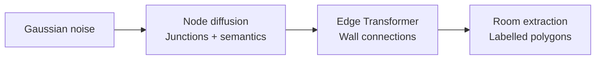

# Constraint-guided floorplan generation with SVDD

We adapt **Soft Value-Based Decoding (SVDD)** to guide a frozen GSDiff model using geometric constraints. At each guided step, we compare possible denoising moves through their predicted floorplans and continue the most promising eligible branch. The experiment tests whether this improves feasibility over ordinary sampling and Best-of-N at comparable denoiser cost.

## GSDiff: generating the geometry of a floorplan

Hu et al.'s **GSDiff: Synthesizing Vector Floorplans via Geometry-enhanced Structural Graph Generation** represents a floorplan through shared wall junctions and wall segments. Its central contribution is to generate this vector structure directly, with room semantics attached to the graph. [Paper](https://arxiv.org/abs/2408.16258)

### Two pretrained components, one generator

For a graph $G=(V,E)$, generation factorizes as

$$
p_{\mathrm{pre}}(G)=p_\theta(V)\,p_\phi(E\mid V).
$$

1. **Node generation:** a Transformer diffusion model generates junction coordinates, surrounding-room semantic attributes and background flags.
2. **Edge prediction:** a second Transformer predicts wall connections between node pairs. Room extraction then identifies closed polygonal loops and assigns room labels.

### What makes it geometry-enhanced?

The paper introduces a **mixed-base alignment loss** to penalize junction misalignment, and **interpolation self-supervision** to improve edge prediction using random intermediate points. These training objectives encourage geometric consistency. The paper also supports topology conditioning through a room-adjacency graph and boundary conditioning through a prescribed exterior contour. [Method, Figures 1–3](https://arxiv.org/pdf/2408.16258)

### Our use of the model

We use the released **unconditional RPLAN** checkpoints because our scenario prescribes neither topology nor boundary. Every comparison shares the same frozen networks and output representation; the original training losses are not optimized during our experiments.

The resulting polygons provide areas and regions for placement checks. Our output schema has no explicit doors, fixtures or ceiling heights, and metric scale remains an assumption. Thus, we evaluate the observable geometric subset rather than infer missing building attributes.

This architecture determines where guidance must act: **we change node-sampling decisions, but score decoded graphs**. Edge prediction and room extraction introduce discrete decisions, making derivative-free SVDD suitable. Instability in early decoded predictions motivates comparing full-trajectory guidance with late guidance. The method must still establish structural validity and constraint satisfaction through final evaluation.

## SVDD-PM: search within the denoising trajectory

**Best-of-N** spends its budget on independent, complete designs and ranks them afterward. **SVDD** repeatedly branches from the current noisy state, using intermediate scores to decide where to continue. Each output retains one active trajectory; the other proposals are discarded at every guided step.

### The energy-tilted target

Our experiment uses **energy-based SVDD-PM**. Let $E(G)$ be the constraint energy defined below and $r(G)=-E(G)$. The [SVDD formulation](https://arxiv.org/html/2408.08252v3) motivates the target

$$
p_\beta(G)=\frac{p_{\mathrm{pre}}(G)e^{-\beta E(G)}}{Z_\beta},
\qquad \beta=1/\tau>0.
$$

This is the distribution minimizing expected violation while penalizing departure from the pretrained prior:

$$
p_\beta=\arg\min_q\left\{
\mathbb E_{G\sim q}[E(G)]
+\frac{1}{\beta}\mathrm{KL}(q\Vert p_{\mathrm{pre}})
\right\}.
$$

Larger $\beta$ strengthens the preference for low energy. Finite $\beta$ still permits violations.

### From final energy to a guided transition

Energy is defined on completed graphs, whereas diffusion operates on noisy nodes. The missing link is the expected terminal weight:

$$
H_t^\beta(z)=\mathbb E_{\mathrm{pre}}\!\left[e^{-\beta E(G)}\mid z_t=z\right],
\qquad
v_t^\beta(z)=\frac{1}{\beta}\log H_t^\beta(z).
$$

$H_t^\beta$ averages over the remaining denoising and edge-generation randomness; $v_t^\beta$ is the **soft value**. Given the pretrained transition $K_t(z'\mid z)$, the ideal reweighted transition is

$$
K_t^\beta(z'\mid z)
=K_t(z'\mid z)\frac{H_{t-1}^\beta(z')}{H_t^\beta(z)},
\qquad
H_t^\beta(z)=\int K_t(u\mid z)H_{t-1}^\beta(u)\,du.
$$

The ratio favors states with better expected terminal weights; the recursion makes it normalized wherever $H_t^\beta(z)>0$. These are ideal conditional transitions. Exact sampling of the full tilted process also requires consistent initial-noise and final-edge weighting, detailed in the [technical notes](technical_notes.md#exact-tilting-of-the-two-stage-generator).

### The posterior-mean approximation

A noisy node state cannot directly support room-area or clearance checks. For each proposal $z$, we predict clean nodes, discretize their semantics, predict edges and extract rooms:

$$
\widehat G_t(z)=D_\phi\!\left[\operatorname{Project}
    \bigl(\widehat z_{\mathrm{clean}}(z,t)\bigr)\right],
\qquad
\widehat H_t^\beta(z)=e^{-\beta E_{\mathrm{GPU}}(\widehat G_t(z))}.
$$

Thus $\widehat v_t(z)=\beta^{-1}\log\widehat H_t^\beta(z)=-E_{\mathrm{GPU}}(\widehat G_t(z))$. Here $D_\phi$ completes the graph. **One clean prediction and graph decode replace the expectation over future completions.** This needs neither rollouts, reward gradients nor a trained value network. The score is not expected terminal reward; early predictions can be unreliable, and GPU geometry is a proxy for the final CPU checker.

### Algorithm: one guided step

Given noisy nodes $z_t$ and $K=10$:

1. **Propose.** Compute the parent clean prediction once. Reuse it to draw $K$ noisy next states from the unchanged DDPM transition, each with independent Gaussian noise: $z_{t-1}^{(k)}\sim p_{\mathrm{pre}}(\cdot\mid z_t)$.
2. **Predict and score.** For each proposal, predict its clean nodes at timestep $t-1$, complete the graph and compute $\widehat v_{t-1}(z_{t-1}^{(k)})$. Sibling proposals share edge-decoder randomness to reduce comparison noise.
3. **Filter.** Require valid structure, finite reward and at least one measurable check. Relative to the first scorable proposal, forbid new unknown constraint IDs; then retain candidates with the fewest unknowns. Call this eligible set $\mathcal E_t$.
4. **Select.** For positive temperature, approximate the reweighted transition by sampling among eligible candidates:

$$
\Pr(k\mid\mathcal E_t)=
\frac{\widehat H_{t-1}^\beta(z_{t-1}^{(k)})}
{\sum_{\ell\in\mathcal E_t}\widehat H_{t-1}^\beta(z_{t-1}^{(\ell)})}
\propto e^{-\beta E_{\mathrm{GPU}}(\widehat G_{t-1}(z_{t-1}^{(k)}))}.
$$

5. **Continue.** Our default $\tau=0$ chooses the highest-scoring eligible proposal. Retain its **noisy state**, discard the other branches and resume denoising. If none is scorable, retain proposal zero.

The clean graph supplies the score; the noisy proposal supplies the next diffusion state. Replacing it with the clean estimate would skip the intended remaining denoising process.

**Guidance window.** Full SVDD applies this loop at code steps `999,…,1`; late SVDD applies it at `200,…,1`. Outside the window, take one ordinary DDPM transition. Both still execute all 1,000 steps, including deterministic, unguided step `0`, before final graph decoding and CPU evaluation.

Finite proposals, clean-estimate rewards, coverage filtering and the greedy default make our implementation **approximate inference-time optimization**. Temperature zero uses a deterministic argmax; it does not exactly sample the feasibility-conditioned model.

## Geometry defines the reward

We score six accessibility/habitability checks from Appendix A of the [assessment](../Technical_assessment_TTC.pdf):

| ID | Geometric requirement |
|---|---|
| **C033** | A bedroom fits a bed and a separate **1.50 m diameter** turning circle. |
| **C035** | Bed clearances: **0.90 m** on both long sides + **1.20 m** at one short side, or **1.20 m + 0.90 m**. Joint success with C033 requires the same bed placement. |
| **C036** | An **empty bathroom** fits a **1.50 m diameter** turning circle. |
| **C076** | One living room/bedroom satisfies **(area ≥9 m² AND height ≥2.20 m) OR volume ≥20 m³**. |
| **C077** | Habitable area ≥**28 m²** for two occupants. |
| **C078** | Habitable volume ≥**66 m³** for two occupants. |

**Assumptions:** 0.025 m/drawing pixel, two occupants, uniform 2.5 m ceilings, a hypothetical axis-aligned 1.40 × 1.90 m bed and zero-thickness walls. Scale and height are supplied. Doors, swings, fixtures and navigable routes are unobserved; requirements needing them are excluded. Supporting rules C034/C079/C080 define measurements without adding compliance points.

**Scale calibration:** the [original RPLAN paper (§4)](https://wutomwu.github.io/publications/2019-DeepLayout/paper.pdf) describes an 18 m square encoded as 256 × 256 pixels. GSDiff's [fixed normalization](../datasets/rplan-process4.py) uses $z=(x_{256}-128)/128$; our [decoder](../test_time/adapter.py) exports $x_{512}=\operatorname{trunc}(256z+256)$. The paper/code-derived conversion is therefore **$18/512=0.03515625$ m per drawing pixel**. The reported experiments instead use an assumed **12.8 m canvas**: their areas are about half those under the dataset-derived scale. Results below characterize that smaller-scale scenario; C035 difficulty should not be attributed to the model at native RPLAN scale without a separate evaluation. Changing final checks alone would not change the scale used during the original guidance.

For applicable, measurable checks $\mathcal M(G)$, equal-weight scalarization gives

$$
E(G)=100\,\mathbf 1\{G\text{ structurally invalid}\}
      +\sum_{j\in\mathcal M(G)}v_j(G),
\qquad r(G)=-E(G).
$$

Bedroom feasibility uses binary penalties. Dimensional deficits use normalized shortfalls $\max(0,(b-q)/b)$, combined according to each rule. **Unknowns add no numeric severity and never count as passes.** Overall validity requires valid structure and every applicable scored check to pass; zero energy alone is insufficient. The [constraint specification](constraints.md) gives exact formulas and assumptions.

## Evaluation and compute

**Protocol:** 100 selected outputs per method, paired seeds `10000–10099`, one fixed scenario, H100 80 GB, generation/inference batches 4/10. The CPU audit rechecks the original outputs; it changes neither generation rewards nor candidate selection.

**Table 1.** All methods score the same **six checks, with 100% applicability**. Validity includes all outputs; brackets give 95% Wilson intervals. Check success is passes/all applicable checks, including unknowns in the denominator. Severity averages measured penalties, excluding unknowns and the structural penalty. Room-count $W_1$ measures distribution shift from baseline (lower is closer).

| Method | Overall valid, % [95% CI] | Check success, % | Severity ↓ | Structure valid, % | Room-count $W_1$ ↓ | NFE/output | Seconds/output |
|---|---:|---:|---:|---:|---:|---:|---:|
| Baseline | 2 [0.6–7.0] | 63.8 | 0.185 | 86 | 0.000 | 1,000 | 3.54 |
| Best-of-11 | 9 [4.8–16.2] | 83.3 | 0.137 | 100 | 0.217 | 11,000 | 20.15 |
| SVDD, last 20% | 14 [8.5–22.1] | 83.7 | 0.142 | 98 | 0.150 | 3,000 | 84.68 |
| SVDD, full | 15 [9.3–23.3] | 85.0 | 0.135 | 99 | 0.138 | 10,990 | 230.05 |

**Compute:** sample-wise denoiser evaluations (NFE) cost $T+KL$ for SVDD and $NT$ for Best-of-N. Multipliers are **1× / 11× / 3× / 10.99×**, respectively. Best-of-11 matches full SVDD within 0.091% in NFE. NFE excludes edge/reward costs: full SVDD takes **11.4× longer** than Best-of-11. Timings exclude loading, rendering and the offline audit.

**Main finding:** SVDD improves observed joint validity, but the benefit is uneven across constraints. Late guidance yields **14 valid designs**, versus **15** for full guidance, using 3,000 rather than 10,990 NFE. On paired seeds there are 12 late-only and 13 full-only successes; this batch does not establish that full guidance is superior. The comparison changes both guidance timing and budget.

### Which constraints improve?

**Figure 1.** Per-constraint passes divided by all 100 selected outputs. Unknowns remain in the denominator and do not count as passes. These are individual-check outcomes; overall validity additionally requires valid structure and joint success. [Vector PDF](assets/sweep_002_cpu_audit_v2/constraint_success.pdf).

- **Bathroom turning space (C036):** success rises from **32%** for baseline to **80%** for Best-of-11 and **97–99%** for SVDD. This is the clearest improvement among the initially difficult checks.
- **Bedroom accessibility (C033/C035):** fitting a bed and turning circle reaches **97–100%** under selection/guidance, but adding circulation clearance remains difficult. Best-of-11 has the highest C035 pass rate (**20%**), ahead of late/full SVDD (**14%/16%**), yet lower overall validity. Improving one constraint does not guarantee better joint performance.
- **Habitability (C076–C078):** baseline already passes **91–93%**; selection/guidance reaches **98–100%**. C077 and C078 have identical outcomes across this sweep. At the assumed 2.5 m height, their area-equivalent thresholds are 28 m² and $66/2.5=26.4$ m², so passing C077 implies C078; these are partly redundant objectives.

### C035 limits joint validity

**Figure 2.** A sole C035 failure means **valid structure and all five other checks passing**. Other outcomes include additional failures, unknowns and invalid structure. This diagnoses the bottleneck; it does not measure how many designs a repair algorithm could fix. [Vector PDF](assets/sweep_002_cpu_audit_v2/c035_bottleneck.pdf).

C035 is the only obstacle in **71 Best-of-11, 81 late-SVDD and 76 full-SVDD designs**. Full SVDD has **80 confirmed C035 failures and four unknowns**: the failures violate necessary geometric bounds, while unknowns remain unresolved placement searches. The low success rate therefore persists even after the improved CPU audit; it is predominantly a geometric limitation under the assumed scale.

For the assumed 1.40 × 1.90 m bed, the two clearance options require rectangular envelopes of **3.20 × 3.10 m** or **3.80 × 2.80 m**. Hence **9.92 m² is a necessary minimum**, not a sufficient condition: room shape and a shared bed/turning-circle placement still matter. The binary C035 penalty gives the same score to all confirmed failures, providing little information about incremental geometric improvement. This motivates the repair-aware extension, whose results are still pending.

**Diversity:** among usable, structurally valid outputs (86/100/98/99), all graphs are unique and mean pairwise semantic-layout distance stays near **0.804–0.807**. These diagnostics show no obvious collapse, but neither establish RPLAN fidelity nor rule out changes in unmeasured layout features. [Metrics and complete analysis](../test_time/outputs/sweep_002_cpu_audit_v2/analysis/REPORT.md).

### What success and failure look like

**Figure 3.** Saved floorplans at the same drawing scale, with room types labelled. The first valid full-SVDD output (seed **10009**) is paired with its baseline; the third panel is the first invalid full-SVDD output (seed **10000**). Furniture/turning-space overlays are hypothetical checker witnesses, not predicted furnishings. [Vector PDF](assets/sweep_002_cpu_audit_v2/qualitative_examples.pdf).

The paired baseline fails **C035 and C036**: its largest bedroom is **8.41 m²**, and its bathroom's turning-circle diameter upper bound is **1.20 m**. Full SVDD passes all six checks, with a shared bedroom placement and **49.30 m²** habitable area. The separate failed SVDD example passes C033 and C036 but has bedrooms of only **7.77 and 7.07 m²**, demonstrating why turning space alone does not establish C035 clearance. These are different generated outputs, not before/after repairs. [Detailed successful design](assets/svdd_full_seed10009.svg) · [Vector graph](assets/svdd_full_seed10009_graph.json) · [Check evidence](assets/svdd_full_seed10009_evaluation.json).

The successful graph's habitable polygon union is **78,875 drawing-pixel²**: $78{,}875\times0.025^2=49.296875$ m². This fits within the assumed $12.8^2=163.84$ m² canvas. At the paper/code-derived scale, the same union would measure **97.49 m²**; all quoted dimensions above retain the original experimental assumption.

### Assessment coverage

The experiments address the assessment's baseline comparison, compute accounting, guidance-window ablation and annotated vector outputs. [Reproduction instructions](../test_time/README.md), [sweep launcher](../test_time/launch_eval.sh) and [machine-readable constraints](../test_time/configs/constraints_v2.json) accompany this report. New logic lives in `test_time/`; the upstream change to [`house_nn2.py`](../gsdiff/house_nn2.py) supplies reproducible edge randomness. The registry's explicit per-rule severity formulas/output-field mapping still need completing; formulas are currently documented separately.

This evaluation covers one fixed scenario and one seed batch; broader replication remains necessary.

## Practical limits

**GPU evaluation** batches room extraction and constraint searches, avoiding repeated CPU geometry work inside the guidance loop. Final metrics use the CPU reference checker; search outcomes and severities can differ between backends.

Finite searches may remain unknown, binary penalties provide weak incremental feedback, and greedy selection may reduce diversity. At the assumed height, C077 already implies C078, partly duplicating the objective. Results establish feasibility under the stated assumptions; baseline-relative diagnostics do not establish RPLAN fidelity.

[Technical notes](technical_notes.md) retain checkpoint details, exact process-weighting equations, assessment alignment and extended results tables.

## Extensions: late hard-feasibility and repair-aware SVDD

These two extensions keep the frozen checkpoints, six scored constraints and scenario assumptions above. **Results for these new extensions are pending**; the preceding audited experiments are unchanged.

### Binary-rollout conditioning (`hard_h_mc`)

Let $C(G)=1$ only when structure and every applicable scored check pass. Unknowns are nonsuccesses. The desired distribution and continuation probability are

$$
p_F(G)=\frac{p_{\mathrm{pre}}(G)C(G)}{\Pr_{\mathrm{pre}}(C=1)},
\qquad h_t(z)=\mathbb E_{\mathrm{pre}}[C(G)\mid Z_t=z].
$$

Writing $q=\Pr_{\mathrm{pre}}(C=1)>0$, the ideal block kernel and first-anchor marginal are

$$
K^F_{a\to b}(z_b\mid z_a)
=K_{a\to b}(z_b\mid z_a)\frac{h_b(z_b)}{h_a(z_a)},
\qquad p_b^F(z)=\frac{p_b(z)h_b(z)}{q},
$$

with the kernel defined wherever $h_a(z_a)>0$. We draw **$K=4$ block proposals** and complete each with **$L=4$ independent unguided rollouts**:

$$
\widehat h_k=\frac1L\sum_{\ell=1}^{L}C(G_{k\ell}),
\qquad \Pr(I=k\mid\text{bank})=\frac{\widehat h_k}{\sum_j\widehat h_j}.
$$

Continuous severity never enters this stochastic selection. The faster default reduces $L$ from 16 to 4, giving noisier estimates and more all-zero banks. Anchors retain **200, 100 and 30 remaining transitions**. Independent initial noises and ordinary prefixes form the first bank, approximating $p_b^F$. Each completion includes GSDiff's actual edge decoder: random interpolation followed by edge-logit argmax and graph extraction.

Neural continuations are batched on GPU; completed-rollout feasibility uses the CPU audit. An all-zero bank triggers a recorded fresh ordinary block: zero observed successes do not prove impossibility. The final bank contains eight completions; selection is uniform among verified successes, otherwise the attempt fails. Finite proposal/rollout/terminal banks, fallbacks and a **40,000-NFE attempt cap** make this approximate conditioning. Success rates include failed attempts; retaining only successful episodes can further bias the distribution.

**Naming and target:** `hard_h_mc` estimates binary continuation probabilities online. The paper's [SVDD-MC (§4.3)](https://arxiv.org/html/2408.08252v5#S4.SS3) instead learns a value estimator by regression. The notes' limit $p_\beta\to p_F$ as $\beta\to\infty$ requires $E=0$ exactly on the feasible set. Our unknown checks carry no numeric severity, so $E=0$ alone does **not** establish feasibility; the explicit pass predicate is essential.

### Bounded repair lookahead (`svdd_repair_aware`)

At steps **200…1**, four noisy proposals are scored through bounded repairs of their predicted clean graphs. This is the **coordinate-only, greedy feasibility-first variant**. Among eligible found repairs $G'$, minimize the following tuple lexicographically:

$$
\mathcal L_G(G')=\left(1-C_{\mathrm{GPU}}(G'),\ U_{\mathrm{GPU}}(G'),\ E_{\mathrm{GPU}}(G'),\ D(G',G)\right),
\qquad
D(G',G)=\frac{\sum_i\|v'_i-v_i\|_2\;\text{(metres)}}{2.4\;\text{m}}.
$$

Here $C_{\mathrm{GPU}}$ is joint proxy feasibility and $U_{\mathrm{GPU}}$ counts unknown checks. Tensor proposals translate internal collinear junction groups by **±0.10 or ±0.20 m**, including bounded two-group combinations. Limits are **0.20 m per junction**, 12 moved junctions and 2.4 m total displacement, preserving adjacency, semantics and the exterior footprint. Search includes the unchanged graph and forbids introducing unknown checks.

For each predicted clean graph $\widehat G_k$, let $\mathcal S_B(\widehat G_k)$ be its finite eligible repair bank, and $\mathcal I_t$ the eligible noisy proposals. The two selections are

$$
\begin{aligned}
G_k^\star&=\operatorname*{arg\,min}^{\mathrm{lex}}_{G'\in\mathcal S_B(\widehat G_k)}\mathcal L_{\widehat G_k}(G'),\\
k^\star&=\operatorname*{arg\,min}^{\mathrm{lex}}_{k\in\mathcal I_t}\mathcal L_{\widehat G_k}(G_k^\star),
\qquad Z_{t-1}=Z_{t-1}^{(k^\star)}.
\end{aligned}
$$

An empty eligible repair bank falls back to its unchanged graph. The chosen **original noisy proposal** continues diffusion; with no eligible noisy proposal, ordinary proposal zero is retained. Inner scoring permits **16 repair evaluations per proposal**. Final repair permits 128 and applies the best eligible edit under the CPU ranking, additionally requiring preserved passes, no worsened severities and unchanged topology/footprint. Before/after graphs and edit costs remain distinguishable.

**Difference from the proposed weighted formulation:** the notes minimize $E+\lambda\|\Delta V\|^2$ (optionally with edge edits), then sample with weights $\exp(-\beta R)$. Our lexicographic rule uses fixed edges and summed displacement as its last tie-breaker; it is not that weighted objective's zero-temperature limit. The finite search supplies a repair witness, without global optimality. If every candidate retains the same feasibility, unknown count and energy—common with binary C035—the unchanged graph wins with zero displacement.

Final repair changes the output distribution and may still leave failed constraints. This combined intervention does not isolate guidance from final-repair effects; no ablation result, compute match or exact feasibility-conditioned distribution is claimed.

The [launcher](../test_time/launch_extensions.sh) previews repair-aware SVDD first, then `hard_h_mc`; `--run` executes that order. Defaults are 100 attempts per method starting at seed 10000, with inference microbatches of **32**, saved under `test_time/outputs/extensions_001/`. `--smoke` retains two attempts with two hard-h rollouts and two terminal completions. Saved per-run configurations define the actual budgets, including earlier runs with $L=16$. See [reproduction instructions](../test_time/README.md).
