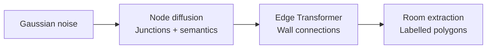
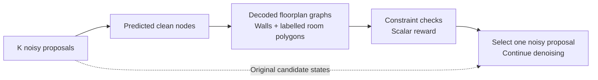
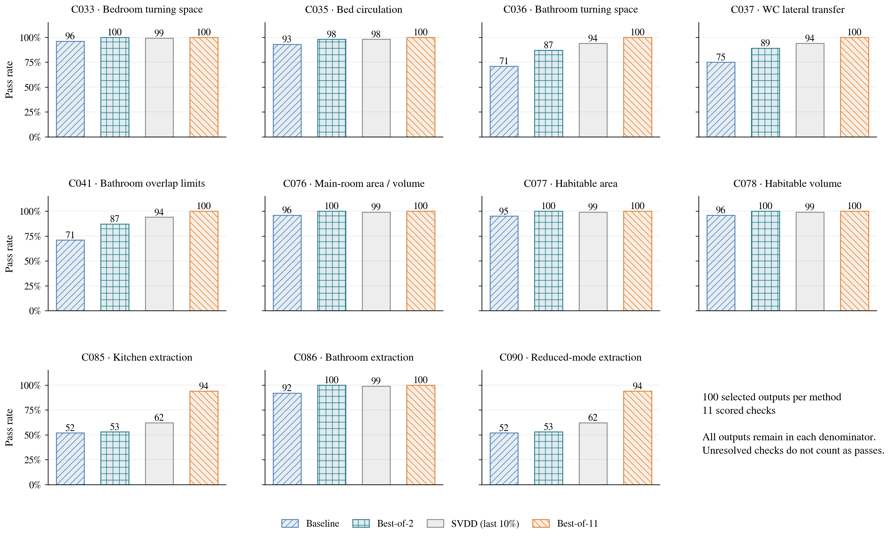
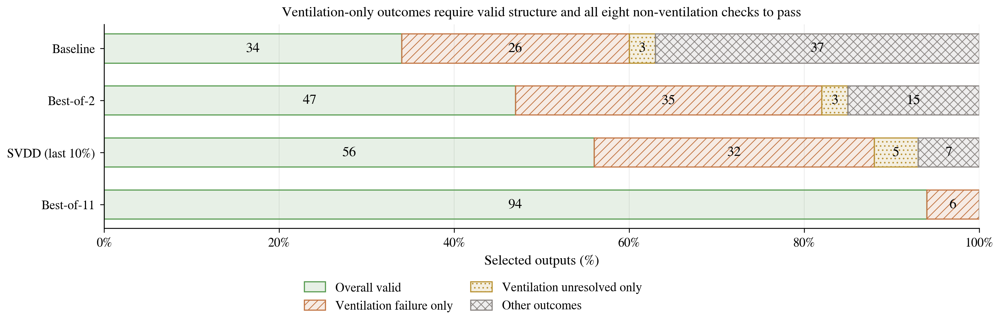
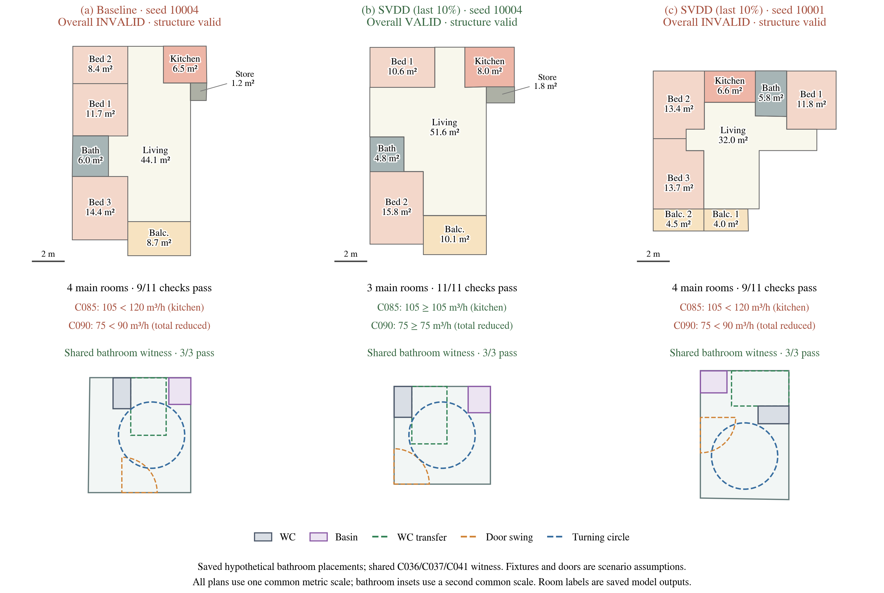
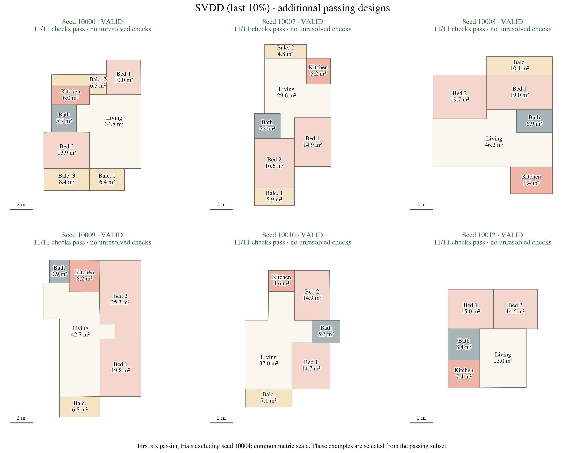
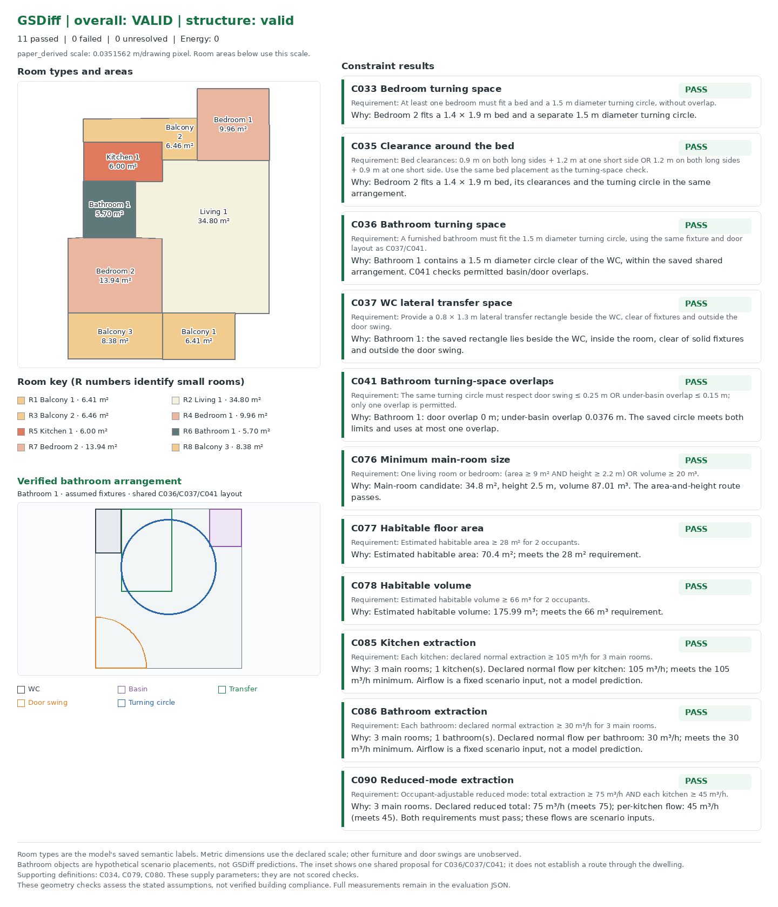
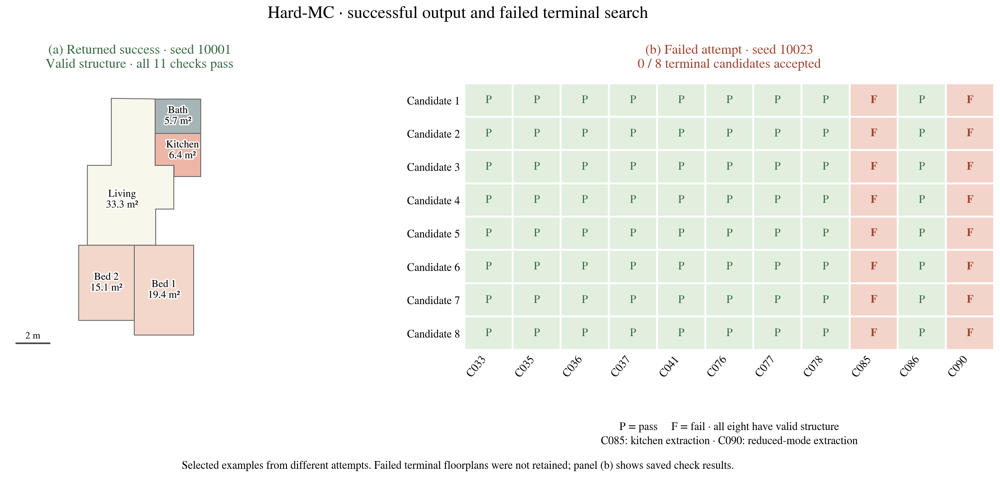

# Constraint-Guided Floorplan Generation with SVDD

We adapt **Soft Value-Based Decoding (SVDD)** to guide a frozen GSDiff model using geometric constraints.

## Background - GSDiff: Generating the Geometry of a Floorplan

Hu et al.'s [**GSDiff**](https://arxiv.org/abs/2408.16258) generates floorplans as graphs: nodes mark wall junctions, and edges represent the wall segments connecting them. The graph also carries **room-type labels**, such as living room, bedroom, kitchen or bathroom. These labels are what we mean by *room semantics*: they describe the intended use of each space. In our experiments, they tell us which constraints to check in each room—for example, bed clearances in bedrooms and turning space in bathrooms.

### Two Pretrained Components, One Generator

For a graph $G=(V,E)$, generation factorizes as

$$
p_{\mathrm{pre}}(G)=p_\theta(V)\,p_\phi(E\mid V).
$$

1. **Node generation:** a Transformer diffusion model generates junction coordinates, surrounding-room semantic attributes and background flags.
2. **Edge prediction:** a second Transformer predicts wall connections between node pairs. Room extraction then identifies closed polygonal loops and assigns room labels.

### Our Use of the Model

We use the **unconditional RPLAN checkpoints** to test whether inference-time guidance can improve satisfaction of the selected regulatory checks without a prescribed room-adjacency graph or building footprint. All methods use the same frozen networks and output representation; no model weights are updated.

- **Where guidance acts:** we choose which node-sampling proposals to continue by scoring their decoded floorplans, where room dimensions and clearances can be checked.
- **Why SVDD:** some checks provide binary feedback. For example, [C035's bed-clearance check](constraints.md#c033-and-c035--binary-placement-penalties) contributes **0** to the reward for a verified pass and **−1** for a proven failure; unresolved cases remain unknown. This discontinuous feedback provides no useful gradient towards a better layout. SVDD compares scores directly, without requiring gradients through these checks, edge prediction or room extraction.
- **When to guide:** early floorplan predictions can be unreliable. We therefore compare guidance throughout denoising with guidance restricted to the **last 10% of steps** (100 guided steps).
- **Other model choices:** GSDiff also releases [topology-constrained and boundary-constrained checkpoints](https://github.com/SizheHu/GSDiff#params-place-in-the-outputs-folder). These could support future experiments where room adjacencies or the building footprint are specified in advance.

## SVDD-PM: Search within the Denoising Trajectory

We choose **SVDD-PM** because it can guide generation using a reward that is **not assumed to be differentiable**. Our checks involve discrete graph decoding, binary decisions and finite placement searches. SVDD needs only their scalar scores, allowing us to guide the frozen model without backpropagating through the reward or geometry checker.

At each guided step, SVDD draws several proposals from the current noisy state and scores their predicted clean floorplans. It then selects one noisy proposal to continue denoising. Each output therefore follows one active trajectory, with the reward informing which branch survives at each guided step.

The decoded graphs supply the scores; the selected **noisy state** continues the trajectory.

We benchmark against **Best-of-N**, which generates $N$ independent, complete designs and applies the same selection rule afterward. This comparison tests whether using the reward during denoising improves constraint satisfaction over selecting from a larger pool of finished designs. Denoiser budgets are accounted for in the evaluation below.

### The Energy-Tilted Target

Our experiment uses **energy-based SVDD-PM**. Let $E(G)$ be the constraint energy defined below and $r(G)=-E(G)$. The [SVDD formulation](https://arxiv.org/html/2408.08252v3) motivates the target

$$
p_\beta(G)=\frac{p_{\mathrm{pre}}(G)e^{-\beta E(G)}}{Z_\beta},
\qquad \beta=1/\tau>0.
$$

This is the distribution minimizing expected violation while penalizing departure from the pretrained prior:

$$
p_\beta=\arg\min_q\left\{
\mathbb E_{G\sim q}[E(G)]
+\frac{1}{\beta}\mathrm{KL}(q\Vert p_{\mathrm{pre}})
\right\}.
$$

Larger $\beta$ strengthens the preference for low energy. Finite $\beta$ still permits violations.

### From Final Energy to a Guided Transition

Energy is defined on completed graphs, whereas diffusion operates on noisy nodes. The missing link is the expected terminal weight:

$$
H_t^\beta(z)=\mathbb E_{\mathrm{pre}}\!\left[e^{-\beta E(G)}\mid z_t=z\right],
\qquad
v_t^\beta(z)=\frac{1}{\beta}\log H_t^\beta(z).
$$

$H_t^\beta$ averages over the remaining denoising and edge-generation randomness; $v_t^\beta$ is the **soft value**. Given the pretrained transition $K_t(z'\mid z)$, the ideal reweighted transition is

$$
K_t^\beta(z'\mid z)
=K_t(z'\mid z)\frac{H_{t-1}^\beta(z')}{H_t^\beta(z)},
\qquad
H_t^\beta(z)=\int K_t(u\mid z)H_{t-1}^\beta(u)\,du.
$$

The ratio favors states with better expected terminal weights; the recursion makes it normalized wherever $H_t^\beta(z)>0$. These are ideal conditional transitions. Exact sampling of the full tilted process also requires consistent initial-noise and final-edge weighting.

### The Posterior-Mean Approximation

A noisy node state cannot directly support room-area or clearance checks. For each proposal $z$, we predict clean nodes, discretize their semantics, predict edges and extract rooms:

$$
\widehat G_t(z)=D_\phi\!\left[\operatorname{Project}
    \bigl(\widehat z_{\mathrm{clean}}(z,t)\bigr)\right],
\qquad
\widehat H_t^\beta(z)=e^{-\beta E_{\mathrm{GPU}}(\widehat G_t(z))}.
$$

Thus $\widehat v_t(z)=\beta^{-1}\log\widehat H_t^\beta(z)=-E_{\mathrm{GPU}}(\widehat G_t(z))$. Here $D_\phi$ completes the graph. **One clean prediction and graph decode replace the expectation over future completions.** This needs neither rollouts, reward gradients nor a trained value network. The score is not expected terminal reward; early predictions can be unreliable, and GPU geometry is a proxy for the final CPU checker.

### Relation to the Paper's Algorithm

We follow the propose–score–select loop in [SVDD Algorithm 1](https://arxiv.org/html/2408.08252v3), with the following implementation choices:

| Component | Our Implementation |
|---|---|
| Soft-value estimate | SVDD-PM: score the predicted clean floorplan with $\widehat v=-E_{\mathrm{GPU}}(\widehat G)$. |
| Selection | The paper samples with weights $\exp(\widehat v/\alpha)$. Our temperature $\tau$ corresponds to $\alpha$: positive values use categorical sampling; the default $\tau=0$ uses a greedy maximum. |
| Eligible candidates | Additional guards check structure, measurable scores and unknown-constraint coverage before selection. |
| Guidance window | Apply selection only within the chosen window; take ordinary DDPM transitions elsewhere. |
| State carried forward | Keep the selected **noisy proposal**; its clean prediction is used only for scoring. |

### Algorithm: One Guided Step

**$K$ is the number of candidate denoising moves proposed at each guided step**, denoted $M$ in the paper's Algorithm 1. Our standard SVDD setting uses **$K=10$**: draw ten alternatives, score them and keep one. The other nine are discarded, so each trajectory still produces one final floorplan. Best-of-N instead generates $N$ complete floorplans before selecting one. The transition kernel $K_t$ above is a separate mathematical object.

Given noisy nodes $z_t$:

1. **Propose.** Compute the parent clean prediction once. Reuse it to draw $K$ noisy next states from the unchanged DDPM transition, each with independent Gaussian noise: $z_{t-1}^{(k)}\sim p_{\mathrm{pre}}(\cdot\mid z_t)$.
2. **Predict and score.** For each proposal, predict its clean nodes at timestep $t-1$, complete the graph and compute $\widehat v_{t-1}(z_{t-1}^{(k)})$. Sibling proposals share edge-decoder randomness to reduce comparison noise.
3. **Filter.** Require valid structure, finite reward and at least one measurable check. Relative to the first scorable proposal, forbid new unknown constraint IDs; then retain candidates with the fewest unknowns. Call this eligible set $\mathcal E_t$.
4. **Select.** For positive temperature, approximate the reweighted transition by sampling among eligible candidates:

$$
\Pr(k\mid\mathcal E_t)=
\frac{\widehat H_{t-1}^\beta(z_{t-1}^{(k)})}
{\sum_{\ell\in\mathcal E_t}\widehat H_{t-1}^\beta(z_{t-1}^{(\ell)})}
\propto e^{-\beta E_{\mathrm{GPU}}(\widehat G_{t-1}(z_{t-1}^{(k)}))}.
$$

5. **Continue.** Our default $\tau=0$ chooses the highest-scoring eligible proposal. Retain its **noisy state**, discard the other branches and resume denoising. If none is scorable, retain proposal zero.

**Noisy State and Clean Prediction.** Two representations are used at each guided step:

- The **noisy state** is the current, partially denoised set of junction coordinates and room-type attributes. It still contains noise and needs further denoising.
- The **clean prediction** is the model's estimate of the final node values from that noisy state. We decode this estimate into a floorplan to evaluate the constraints. It is a prediction, so it may differ from the layout eventually generated.

SVDD uses the predicted floorplans to rank proposals, then continues denoising from the selected **noisy state**.

**Guidance Window.** Generation starts from Gaussian noise and performs 1,000 denoising updates. The code's timestep counts down from `999` near the noisy beginning to `0` at the final update; smaller timesteps correspond to lower scheduled noise levels.

- **Full SVDD:** compare candidate moves throughout the stochastic denoising steps (`999` to `1`).
- **Late SVDD:** first follow ordinary denoising, then compare candidate moves only in the last-10% window (`100` to `1`).

Both methods finish with the same deterministic update at step `0`, followed by final graph decoding and CPU evaluation. The guidance window controls **when candidate moves are compared**; both methods still complete all 1,000 denoising updates.

Finite proposals, clean-estimate rewards, coverage filtering and the greedy default make our implementation **approximate inference-time optimization**. Temperature zero uses a deterministic argmax; it does not exactly sample the feasibility-conditioned model.

## Constraints Define the Reward

The default profile evaluates **eleven constraints from Appendix A** of the supplied technical assessment, grouped below. **Every method uses all four groups**; `bathroom_001` names the experiment, not a bathroom-only evaluation. Three supporting rules define measurements without adding separate reward terms or compliance points.

### Bedroom — Bed Placement and Clearance

| ID | Requirement |
|---|---|
| **C033** | A bedroom fits a bed and a separate **1.50 m diameter** turning circle. |
| **C035** | Bed clearances: **0.90 m** on both long sides + **1.20 m** at one short side, or **1.20 m + 0.90 m**. Joint success with C033 requires the same bed placement. |

### Bathroom — One Shared Furnishing Arrangement

| ID | Requirement |
|---|---|
| **C036** | A furnished bathroom fits a **1.50 m diameter** turning circle, sharing one fixture/door arrangement with C037/C041. |
| **C037** | A WC has **0.80 × 1.30 m** lateral transfer space, outside the door swing. |
| **C041** | **Bathroom-scoped:** the same turning circle overlaps the door swing by **≤0.25 m OR** the space beneath a basin by **≤0.15 m**; at most one overlap is used. |

### Habitability — Room Size and Dwelling Capacity

| ID | Requirement |
|---|---|
| **C076** | One living room/bedroom satisfies **(area ≥9 m² AND height ≥2.20 m) OR volume ≥20 m³**. |
| **C077** | Habitable area ≥**28 m²** for two occupants. |
| **C078** | Habitable volume ≥**66 m³** for two occupants. |

### Ventilation — Capacity for the Generated Room Count

| ID | Requirement |
|---|---|
| **C085** | Normal kitchen extraction meets the PDF's main-room-count table. |
| **C086** | Normal bathroom extraction meets the PDF's main-room-count table. |
| **C090** | Occupant-adjustable reduced ventilation meets **both total and kitchen** flow minima for the main-room count. |

**Measurement Definitions:** C034 specifies the bed dimensions used by the bedroom checks. C079/C080 define how habitable area is measured and which spaces are excluded, under our stated modelling assumptions. These definitions support the eleven scored checks; they add no separate reward terms or pass/fail results. Overall success rate remains the number of successful designs divided by the total number of designs.

### Shared Scenario and Assumptions

GSDiff provides wall geometry and room types. The checks also need physical dimensions, occupancy, furnishings and building services. We specify these inputs once and use **the same scenario for every method**.

**Shared Inputs**

| Input | Setting |
|---|---|
| Metric scale | **0.03515625 m/drawing pixel**, derived from the dataset and code |
| Occupancy | **2 people** |
| Ceiling height | **2.5 m**, uniform throughout |
| Bed | **1.40 × 1.90 m** from C034; axis-aligned placement assumed |
| Walls | Zero-thickness representation for area estimates |
| Main rooms | Living rooms and bedrooms |
| Bathroom category | Every bathroom label is treated as a full bathroom |

**Assumed Bathroom Layout**

We model a combined bathroom/WC with the objects below. Their dimensions and the combined-room arrangement are **scenario assumptions, not PDF requirements**.

| Object | Assumed Dimensions and Properties |
|---|---|
| Toilet | **0.40 × 0.70 m** |
| Basin | **0.60 × 0.50 m**, with clear space underneath |
| Door | **0.80 m** wide, opening inward |

- **Joint placement:** one search places the fixtures, door swing, transfer rectangle and turning circle together.
- **Overlap rules:** transfer and turning spaces may overlap; interactions with fixtures and the door must satisfy C036/C037/C041.
- **Scope:** C041 applies only to the bathroom turning circle. Bedroom door and fixture overlaps remain unverified.

> **What a Pass Means:** feasibility under the declared scenario. It does not verify a real building's dimensions, installed equipment or accessible routes.

The declared ventilation system is fixed across all methods:

| Operating condition | Declared extraction rate |
|---|---:|
| Normal kitchen, per kitchen | **105 m³/h** |
| Normal bathroom, per bathroom | **30 m³/h** |
| Reduced mode, dwelling total | **75 m³/h** |
| Reduced mode, per kitchen | **45 m³/h** |

These are scenario capacities selected for a three-main-room dwelling; GSDiff generates the room count but does not predict these rates.

The ventilation threshold tables come from **Appendix A, page 7**. The declared capacities represent a three-main-room system and are held constant across methods. Missing equipment mappings or flows remain unknown. C090 is applicable only in the declared occupant-adjustable mode and uses its supplied table only for 1–7 main rooms. The model does not establish installed airflow, duct routing or inlet/outlet placement.

**Scale calibration:** the [original RPLAN paper (§4)](https://wutomwu.github.io/publications/2019-DeepLayout/paper.pdf) describes an 18 m square encoded as 256 × 256 pixels. GSDiff's [normalization](../datasets/rplan-process4.py) uses $z=(x_{256}-128)/128$; our [decoder](../test_time/adapter.py) exports $x_{512}=\operatorname{trunc}(256z+256)$. Therefore,

$$
s=\frac{18}{512}=0.03515625\;\mathrm{m/drawing\ pixel},
\qquad A_{\mathrm{m}^2}=A_{\mathrm{pixel}^2}s^2.
$$

This conversion is derived from the dataset and code conventions, rather than a physical measurement of each generated building. Generation rewards and final checks use the same conversion.

### From Checks to a Scalar Reward

For applicable, measurable checks $\mathcal M(G)$, equal-weight scalarization gives

$$
E(G)=100\,\mathbf 1\{G\text{ structurally invalid}\}
      +\sum_{j\in\mathcal M(G)}v_j(G),
\qquad r(G)=-E(G).
$$

Bedroom feasibility uses binary penalties. Dimensional and airflow deficits use normalized shortfalls $d(q;b)=\max(0,(b-q)/b)$. C085/C086 use their required flow for the generated main-room count. C090 uses $\max\{d(q_T^r;b_T^r),d(q_K^r;b_K^r)\}$ so sufficient total flow cannot compensate for insufficient kitchen flow. All eleven final checks have weight one. **Unknowns add no numeric severity and never count as passes.** Overall validity requires valid structure and every applicable scored check to pass; zero energy alone is insufficient.

**A shared bathroom search supplies a graded guidance score.** The same bounded bank of fixture/door placements and circle centres is used for every method. For a completion $a$, let $\ell(G,a)\geq0$ measure normalized containment, collision and permitted-overlap shortfalls. GPU guidance uses

$$
P_{\mathrm{bath}}(G)=\min_{a\in\mathcal A(G)}\ell(G,a),
\qquad
E_{\mathrm{GPU}}(G)=100\mathbf1\{\mathrm{invalid}\}
+\sum_{j\in\mathcal M(G)\setminus\{\mathrm{C036,C037,C041}\}}v_j(G)
+P_{\mathrm{bath}}(G).
$$

The joint term replaces the three bathroom severities during selection, avoiding counting the same geometric deficit three times. It gives near misses an ordering without labelling them proven failures. Final CPU reporting checks all three PDF rules separately; a finite search miss remains **unknown** unless a necessary geometric bound proves failure. The chosen shared arrangement is saved and drawn in the sample figures. [Constraint formulas](constraints.md) and the [bathroom protocol](bathroom_profile.md) specify the assumptions, overlap convention and search limitations.

## Evaluation and Compute

**Protocol:** the main comparison uses 100 selected designs per completed method, paired trial seeds `10000–10099`, the same frozen checkpoints, eleven scored checks and the declared 18 m canvas scenario. All final outcomes use the CPU bathroom audit. Hard-MC additionally completed 100 attempts under the same scenario and seeds; its results appear below. Full SVDD remains **pending**; full evaluation of repair-aware SVDD was deferred due to **time constraints**.

**Table 1.** Overall validity requires valid structure and every applicable scored check to pass. Brackets give 95% Wilson intervals. Check success is passes/all applicable checks, including unknowns in the denominator; all eleven checks are applicable here. Severity averages measured per-check penalties, excluding unknowns and the structural penalty. Room-count $W_1$ measures distribution shift from baseline on usable, structurally valid layouts. The full-SVDD NFE budget is planned.

| Method | Overall valid, % [95% CI] | Check success, % | Severity ↓ | Structure valid, % | Room-count $W_1$ ↓ | NFE/output | Seconds/output |
|---|---:|---:|---:|---:|---:|---:|---:|
| Baseline | 34 [25.5–43.7] | 80.8 | 0.0280 | 86 | 0.000 | 1,000 | 3.54 |
| Best-of-2 | 47 [37.5–56.7] | 87.9 | 0.0166 | 99 | 0.108 | 2,000 | — |
| SVDD, last 10% | **56 [46.2–65.3]** | **90.8** | 0.0176 | 99 | 0.098 | **2,000** | 106.30 |
| Best-of-11 | 94 [87.5–97.2] | 98.9 | 0.00159 | 100 | 0.416 | 11,000 | 20.15 |
| SVDD, full | Pending | — | — | — | — | 10,990 | — |

**Main finding:** late SVDD improves observed validity by **9 percentage points over Best-of-2 at equal NFE**. On paired seeds, 19 designs succeed only with SVDD and 10 only with Best-of-2; 37 succeed with both. A paired bootstrap gives a 95% interval of **−1 to +19 points**, so this batch suggests a benefit without establishing superiority. Best-of-11 reaches 94% using **5.5×** the denoiser budget; its matched full-SVDD comparison is pending.

**Compute:** for $T=1{,}000$, SVDD costs $T+KG$ and Best-of-N costs $NT$ sample-wise denoiser evaluations. Here $K=10$, $G=100$, so both late SVDD and Best-of-2 cost 2,000 NFE/output. Controls use generation/inference batches **4/10**, versus **10/32** for SVDD. Its 106.30 s/output is amortized sampling/checking time (2.95 hours total), excluding setup and rendering/export. Edge-model and reward costs are not matched. Based on late-guidance timing, full SVDD is estimated to take about **30 hours for 100 outputs** on the H100.

**Candidate reuse:** baseline and Best-of-11 reuse saved graphs rescored under the current scenario. Best-of-2 selects from fixed candidate indices 0 and 1 of each Best-of-11 trial using saved GPU scores, followed by CPU validation. Its NFE is the equivalent retained-trajectory cost; reselection performs no new model inference. The controls are nested. Baseline and Best-of-11 timings cover generation with six checks and exclude the current rescoring, so wall times are not directly comparable with SVDD. Standalone Best-of-2 runtime remains unmeasured (—).

### Which Constraints Improve?

**Figure 1.** Passes per 100 selected designs; unknowns remain nonsuccesses. These individual rates do not replace joint validity. [Vector PDF](assets/bathroom_001/constraint_success.pdf).

- **Bathroom layout (C036/C037/C041):** late SVDD reaches **94%** for all three checks, versus **87%/89%/87%** for Best-of-2. Bathroom unknowns fall from **10–11** designs to **one**, although confirmed failures rise to five per check. This explains why overall success improves while mean measured severity is slightly higher.
- **Ventilation (C085/C090):** pass rates rise from **53% to 62%** at matched NFE. The declared fixed airflow capacities make generated room count consequential; this is scenario-conditioned feasibility, not a prediction of installed ventilation.
- **Bedroom and habitability:** C035 passes **98%** under both methods. C076–C078 pass **99%** with SVDD and 100% with Best-of-2. Bedroom clearance is no longer the dominant obstacle in this corrected-scale profile.

### Ventilation Limits Joint Validity

**Figure 2.** Ventilation-only categories require valid structure and all eight non-ventilation checks to pass. They distinguish confirmed airflow failures from unresolved checks; remaining outcomes form a separate category. [Vector PDF](assets/bathroom_001/ventilation_bottleneck.pdf).

For late SVDD, **32 designs fail only ventilation**, and another **five** have ventilation-only unknowns because no kitchen polygon is available to map the declared kitchen flows. Seven remaining designs have other obstacles. Best-of-11 has six failures, all ventilation-only. The two failing ventilation rules often respond to the same main-room count, so they should not be interpreted as independent failure mechanisms.

### What Success and Failure Look Like

**Figure 3.** Common drawing scale and labelled room types. Seed **10004** is the first trial where SVDD passes and baseline fails; seed **10001** is the first invalid SVDD trial. This deterministic selection illustrates outcomes, not representative improvement or a before/after repair. Fixtures and turning spaces are hypothetical checker witnesses. [Vector PDF](assets/bathroom_001/qualitative_examples.pdf) · [Source graphs and check evidence](assets/bathroom_001/qualitative_examples_sources.json).

At seed 10004, baseline has **four main rooms** and fails C085/C090: the required kitchen flow is **120 m³/h**, exceeding the supplied 105, and reduced total flow requires **90 m³/h**, exceeding 75. SVDD generates **three main rooms** and passes all eleven checks. The failed SVDD example at seed 10001 retains four main rooms and the same airflow deficits despite passing all bathroom checks.

**Figure 4.** Six further examples from the **56 passing late-SVDD outputs**: the first six passing trials in seed order, excluding seed 10004 already shown above. Each has valid structure, **11/11 checks passing** and no unresolved checks. All panels use a common metric scale. [Vector PDF](assets/bathroom_001/svdd_passing_examples.pdf) · [Selection and source data](assets/bathroom_001/svdd_passing_examples_sources.json).

The detailed SVGs use the labelled-floorplan and constraint-card layout: each check states its requirement and why it passes, alongside the saved bathroom arrangement. Open seeds [10000](assets/bathroom_001/passing_svdd/svdd_last10_seed10000.svg), [10007](assets/bathroom_001/passing_svdd/svdd_last10_seed10007.svg), [10008](assets/bathroom_001/passing_svdd/svdd_last10_seed10008.svg), [10009](assets/bathroom_001/passing_svdd/svdd_last10_seed10009.svg), [10010](assets/bathroom_001/passing_svdd/svdd_last10_seed10010.svg) or [10012](assets/bathroom_001/passing_svdd/svdd_last10_seed10012.svg). These use the current **0.03515625 m/drawing pixel** scenario and eleven checks.

Detailed passing example — late SVDD, seed 10000

### Diversity, Reproduction and Assessment Coverage

All **86/99/99/100** usable, structurally valid graphs (baseline/Best-of-2/late SVDD/Best-of-11) are unique. Mean pairwise semantic-layout distance stays within **0.804–0.810**. These diagnostics show no exact-duplicate collapse, while Best-of-11 has the largest room-count shift from baseline. Fixed-canvas diversity measures do not establish fidelity to real floorplans; no RPLAN reference dataset was available for FID/KID. The [saved metrics and provenance](assets/bathroom_001/result_audit.json) include the diversity results and source hashes.

This evaluation supplies the assessment's frozen-model baseline, explicit constraint subset and assumptions, scalar reward, matched-NFE comparison, per-check outcomes, failure analysis and annotated vector outputs. Hard-MC adds a completed extension evaluation. The full-versus-late ablation remains pending; full repair-aware evaluation was deferred due to time constraints. One scenario and one batch of 100 paired trials limit generalization. [Numerical audit](assets/bathroom_001/result_audit.json) · [Figure generator](../test_time/report_assets.py) · [Reproduction instructions](../test_time/README.md) · [Constraint definitions](../test_time/configs/constraints_bathroom_v1.json).

## Practical Limits

**Fast Scoring, Common Evaluation**

- **GPU:** scores many proposals quickly, helping the sampler choose promising moves.
- **CPU:** checks completed layouts with the same reference evaluator for every method, including independent geometry checks of proposed placements.

A good guidance score alone does not establish validity. The CPU hosts our Shapely geometry implementation; **non-differentiable rewards do not inherently require a CPU**.

**Example: C036 — Bathroom Turning Space**

At least one bathroom must fit a **1.50 m diameter turning circle**, inside the room and clear of the toilet. The GPU searches possible arrangements and ranks their geometric shortfalls. The CPU repeats the same finite search and independently verifies claimed passes.

| Result | What It Means in This Example |
|---|---|
| **Pass** | A circle placement is found and verified within the shared bathroom arrangement. |
| **Fail** | For example, every bathroom is rectangular and only **1.40 m wide**: a **1.50 m** circle cannot fit, even before adding fixtures. |
| **Unknown** | No tested arrangement gives a verified placement, but no geometric bound proves that placement is impossible. |

The width example is illustrative. Door and basin overlaps are checked separately by C041 using the same arrangement. **An unsuccessful search is not proof of failure.**

**Other Limits**

- **Feedback:** binary bedroom penalties give little information about incremental improvements.
- **Diversity:** greedy selection may narrow the range of layouts, so success rates must be read alongside room counts and diversity.
- **Overlapping checks:** some constraints share geometry or imply others, so eleven checks do not represent eleven independent challenges.

Checker Details and Dependencies Between Constraints

Bathroom evaluation uses the same bounded placement bank on both backends, with independent CPU verification of positive placements. Bedroom evaluation additionally uses a refined placement search. Neither search is exhaustive.

Standard SVDD uses the CPU checker after generation. Hard-feasibility MC also audits rollout outcomes, and final repair audits candidate edits; these checks add runtime. Equivalent verification could run on GPU after implementation and validation.

At the assumed height, C077 implies C078. C036/C037/C041 share one bathroom arrangement. Fixed ventilation capacities link C085 and C090, while the declared bathroom flow satisfies C086 across its table. Baseline-relative diagnostics do not establish fidelity to RPLAN.

[Technical notes](technical_notes.md) retain checkpoint details and exact process-weighting equations; their historical results are separate from this evaluation.

## Extensions: Late Hard-Feasibility and Repair-Aware SVDD

We propose two extensions to improve the information used for branch selection: **the chance of eventual success** and **the feasibility attainable through small repairs**. Both are implemented using the same frozen checkpoints, eleven scored constraints and declared scenario, without reward gradients. Decisions are concentrated in the **last 10% of denoising**, within the final 100 transitions, where proposals have less noisy geometry. **Hard-MC completed 100 attempts; full repair-aware evaluation was deferred due to time constraints.**

### Hard-Feasibility MC: Predicting Eventual Success (`hard_h_mc`)

SVDD-PM judges each proposal through a single predicted clean graph. A low violation score at that point need not imply that continued denoising will satisfy every constraint. This extension completes several unguided rollouts from each proposal and favours branches with more CPU-audited successes. It tests whether estimating final joint feasibility provides better branch selection than the immediate clean-estimate score.

Let $C(G)=1$ only when structure and every applicable scored check pass. Unknowns are nonsuccesses. The desired distribution and continuation probability are

$$
p_F(G)=\frac{p_{\mathrm{pre}}(G)C(G)}{\Pr_{\mathrm{pre}}(C=1)},
\qquad h_t(z)=\mathbb E_{\mathrm{pre}}[C(G)\mid Z_t=z].
$$

Writing $q=\Pr_{\mathrm{pre}}(C=1)>0$, the ideal block kernel and first-anchor marginal are

$$
K^F_{a\to b}(z_b\mid z_a)
=K_{a\to b}(z_b\mid z_a)\frac{h_b(z_b)}{h_a(z_a)},
\qquad p_b^F(z)=\frac{p_b(z)h_b(z)}{q},
$$

with the kernel defined wherever $h_a(z_a)>0$. We draw **$K=4$ block proposals** and complete each with **$L=4$ independent unguided rollouts**:

$$
\widehat h_k=\frac1L\sum_{\ell=1}^{L}C(G_{k\ell}),
\qquad \Pr(I=k\mid\text{bank})=\frac{\widehat h_k}{\sum_j\widehat h_j}.
$$

Late SVDD checks ten predicted clean floorplans at each of 100 guided steps. Hard-MC rollouts instead denoise to completion **without intermediate constraint checks**; only completed floorplans are evaluated. Their success fractions select the **noisy proposal at the checkpoint** that continues denoising. The completed lookaheads supply the scores.

Continuous severity never enters this stochastic selection. Decision anchors lie at **100, 50 and 15 transitions remaining**, within the final 10%; their positions are recorded in each run configuration. Independent initial noises and ordinary prefixes form the first bank, approximating $p_b^F$. Each completion includes GSDiff's actual edge decoder: random interpolation followed by edge-logit argmax and graph extraction.

**Main trade-off:** completed rollouts and CPU audits are expensive, and four rollouts per proposal give a coarse success estimate. If every rollout fails, the binary scores cannot distinguish promising near misses from poor layouts. Neural continuations are batched on GPU; an all-zero bank triggers a recorded fresh ordinary block. Zero observed successes do not prove impossibility.

The final bank contains eight completions; selection is uniform among verified successes, otherwise the attempt fails. Finite proposal/rollout/terminal banks, fallbacks and a **40,000-NFE attempt cap** make this approximate conditioning. Success rates include failed attempts; retaining only successful episodes can further bias the distribution.

**Naming and target:** `hard_h_mc` estimates binary continuation probabilities online. The paper's [SVDD-MC (§4.3)](https://arxiv.org/html/2408.08252v5#S4.SS3) instead learns a value estimator by regression. The notes' limit $p_\beta\to p_F$ as $\beta\to\infty$ requires $E=0$ exactly on the feasible set. Our unknown checks carry no numeric severity, so $E=0$ alone does **not** establish feasibility; the explicit pass predicate is essential.

#### Hard-MC Results

Hard-MC returns **83 valid designs from 100 attempts** (95% Wilson interval: **74.5–89.1%**). Every returned design passes all eleven checks. The remaining 17 attempts return no graph and count as unsuccessful.

**Table 2.** Final outcomes, including attempts whose successful lookaheads did not lead to a valid terminal sample.

| Outcome | Attempts |
|---|---:|
| Valid final design returned | 83 |
| No final design; a valid lookahead was found | 13 |
| No valid design found | 4 |

Thus **96 attempts found a feasible completion somewhere in the search**, but the final success rate is **83%**. Lookaheads score intermediate branches; only the final bank supplies returned designs.

**Table 3.** Measured costs include all 100 attempts. Sampling/checking time excludes setup and artifact export; cost per valid design includes unsuccessful attempts.

| Cost | Per attempt | Per returned valid design |
|---|---:|---:|
| NFE | 6,808 | 8,202 |
| Sampling/checking time, seconds | 50.98 | 61.42 |

Hard-MC reaches **83%** success versus **56%** for late SVDD, using **3.4×** its NFE per attempt. Best-of-11 reaches 94% at 11,000 NFE; these extension comparisons have different budgets. The run took **86 minutes** overall, with CPU checking accounting for **67%** of sampling/checking time. [Saved metrics and provenance](assets/hard_mc_overnight_001/result_audit.json) · [All 100 attempts](assets/hard_mc_overnight_001/per_attempt.csv).

**Runtime:** Hard-MC took **50.98 s/attempt**, versus **106.30 s** for late SVDD, despite higher NFE. It evaluated **56 graphs per attempt versus 1,002**, reducing repeated edge decoding, room extraction and constraint searches—a likely explanation for its shorter runtime. NFE counts only denoising and excludes that work.

**Figure 5.** Left: the first returned success, with all eleven checks passing. Right: the first failed attempt where all eight terminal candidates fail only **C085/C090**. Rejected floorplans were not saved; the failure panel shows their recorded checks. [Annotated success](assets/hard_mc_overnight_001/hard_mc_success_seed10001_annotated.svg) · [Vector PDF](assets/hard_mc_overnight_001/hard_mc_examples.pdf) · [Source evidence](assets/hard_mc_overnight_001/examples_sources.json).

### Repair-Aware SVDD: Identifying Layouts That Small Edits Can Improve (`svdd_repair_aware`)

Two predicted layouts can have the same violation score while differing substantially in how easily they can be corrected. This extension searches for small wall adjustments before ranking each proposal, testing whether bounded repairability identifies more promising denoising branches. The best layout found supplies the score; the original noisy proposal continues diffusion. A separate final repair then attempts to improve the completed floorplan. Both stages use explicit edit proposals and score comparisons, without reward gradients.

At steps **100…1**, four noisy proposals are scored through bounded repairs of their predicted clean graphs. We rank outcomes by feasibility first, then fewer unknowns, lower energy and finally smaller displacement. Among eligible found repairs $G'$, this means minimizing the following tuple lexicographically:

$$
\mathcal L_G(G')=\left(1-C_{\mathrm{GPU}}(G'),\ U_{\mathrm{GPU}}(G'),\ E_{\mathrm{GPU}}(G'),\ D(G',G)\right),
\qquad
D(G',G)=\frac{\sum_i\|v'_i-v_i\|_2\;\text{(metres)}}{2.4\;\text{m}}.
$$

Here $C_{\mathrm{GPU}}$ is joint proxy feasibility and $U_{\mathrm{GPU}}$ counts unknown checks. Tensor proposals translate internal collinear junction groups by **±0.10 or ±0.20 m**, including bounded two-group combinations. Limits are **0.20 m per junction**, 12 moved junctions and 2.4 m total displacement, preserving adjacency, semantics and the exterior footprint. Search includes the unchanged graph and forbids introducing unknown checks.

For each predicted clean graph $\widehat G_k$, let $\mathcal S_B(\widehat G_k)$ be its finite eligible repair bank, and $\mathcal I_t$ the eligible noisy proposals. The two selections are

$$
\begin{aligned}
G_k^\star&=\operatorname*{arg\,min}^{\mathrm{lex}}_{G'\in\mathcal S_B(\widehat G_k)}\mathcal L_{\widehat G_k}(G'),\\
k^\star&=\operatorname*{arg\,min}^{\mathrm{lex}}_{k\in\mathcal I_t}\mathcal L_{\widehat G_k}(G_k^\star),
\qquad Z_{t-1}=Z_{t-1}^{(k^\star)}.
\end{aligned}
$$

An empty eligible repair bank falls back to its unchanged graph. The chosen **original noisy proposal** continues diffusion; with no eligible noisy proposal, ordinary proposal zero is retained. Inner scoring permits **16 repair evaluations per proposal**. Final repair permits 128 and applies the best eligible edit under the CPU ranking, additionally requiring preserved passes, no worsened severities and unchanged topology/footprint. Before/after graphs and edit costs remain distinguishable.

**Difference from the proposed weighted formulation:** the notes minimize $E+\lambda\|\Delta V\|^2$ (optionally with edge edits), then sample with weights $\exp(-\beta R)$. Our lexicographic rule uses fixed edges and summed displacement as its last tie-breaker; it is not that weighted objective's zero-temperature limit. The finite search supplies a repair witness, without global optimality. If every candidate retains the same feasibility, unknown count and energy—common with binary C035—the unchanged graph wins with zero displacement.

**Main trade-off:** the score measures what the finite edit search can find. Its proposal order favours enlarging the largest bedroom and does not specifically target the coupled bathroom checks. Small coordinate changes may be insufficient, and the search does not establish the minimum repair needed. Final repair can still leave failed constraints and changes the output distribution. Results therefore describe the combined guidance-and-final-repair procedure; they do not isolate either stage or establish a compute match or exact feasibility-conditioned sampling.

The [launcher](../test_time/launch_extensions.sh) previews repair-aware SVDD first, then `hard_h_mc`; `--run` executes that order. Defaults are 100 attempts per method starting at seed 10000, with inference microbatches of **32**, saved under `test_time/outputs/bathroom_extensions_001/`. `--smoke` retains two attempts with two hard-h rollouts and two terminal completions. Saved per-run configurations define the actual budgets, including earlier runs with $L=16$. See [reproduction instructions](../test_time/README.md).

### Constraint-Checking Cost Beyond NFE

Repair-aware SVDD searches inside every guided step. With $G$ guided steps, $K$ proposals and at most $B$ repair candidates per proposal (including the unchanged graph), its inner GPU scoring budget per attempt is

$$
N_{\mathrm{repair}}\leq GKB.
$$

The [extension configuration](../test_time/configs/extensions_bathroom_v1.json) uses **100 repair steps**, giving

$$
N_{\mathrm{repair}}\leq
\underbrace{100}_{\text{steps}}\times
\underbrace{4}_{\text{proposals}}\times
\underbrace{16}_{\text{repair candidates}}
=\boxed{6{,}400\text{ graph evaluations}}.
$$

Each evaluation extracts rooms and checks constraints, including the bathroom placement search. Final repair adds up to 128 GPU-scored candidates and CPU validation. Saved run configurations determine the actual budget.

Hard-MC checks completed plans at three decision anchors. With four proposals, four rollouts per proposal and eight terminal candidates, a complete attempt requires

$$
N_{\mathrm{MC}}=3\times4\times4+8
=\boxed{56\text{ completed-plan CPU audits}}.
$$

Budget exhaustion can reduce this count; fresh-base fallbacks add denoising work. Hard-MC spends more on neural continuations, while repair-aware repeatedly searches intermediate geometry. **NFE alone misses much of repair-aware's cost:** report constraint-evaluation counts, checking time and total elapsed time alongside NFE. GPU proxy evaluations and CPU audits also have different costs, so their count ratio is not a runtime speedup.

## Future Directions

### Faster Sampling and Model Execution

- **Fewer denoising steps:** investigate [DDIM](https://arxiv.org/abs/2010.02502) with a shorter sampling schedule and guidance windows defined by noise level. Our SVDD proposal mechanism needs distinct candidates: deterministic DDIM from the same parent would require added stochasticity or an alternative proposal mechanism.
- **One-step steerability:** investigate distillation approaches such as [consistency models](https://arxiv.org/abs/2303.01469), then test steering through initial-noise search, candidate selection or conditioning a distilled student. Reliable one-step generation would require adaptation and validation; it removes the intermediate branch-selection opportunities used by current SVDD.
- **Quantization and caching:** assess lower-precision inference, informed by [Q-Diffusion](https://arxiv.org/abs/2302.04304), and reuse of intermediate Transformer features across timesteps, inspired by [TokenCache](https://arxiv.org/abs/2409.18523). Both require adaptation to GSDiff and checks that approximation errors preserve graph structure and constraint outcomes. Caches must respect separate candidate trajectories.

Measure **total generation-and-checking time, audited validity and diversity together**: faster neural inference may leave edge decoding or reward evaluation as the dominant cost.

### Learned Rewards and Visual Question Answering

**Learn a cheaper constraint scorer.** Train a compact graph model on a separate set of CPU-audited plans and their scenario variables to predict per-constraint status, severity and a scalar guidance reward. Include intermediate predicted graphs across timesteps, and retain unknown outcomes as a separate category. Validate false-pass rates on held-out plans and keep the reference checker for final evaluation.

**Explore a VLM/VQA reward.** Inspired by [TIFA's question-based image evaluation](https://arxiv.org/abs/2303.11897), ask constraint-specific questions about labelled floorplan renderings, supplied dimensions and scenario metadata. Renderings must exclude checker verdicts to avoid leaking the answers. Such a model could estimate whether a plan satisfies the requested conditions, but its geometric accuracy and calibration need validation against the reference checks. A large VLM may itself be expensive; using it offline as a teacher for a smaller reward model is another option. Any claimed speedup must include rendering and reward inference.

### Feynman–Kac Steering as Alternative to SVDD

Given more time, we would also investigate [**Feynman–Kac steering** (Singhal et al., ICML 2025)](https://proceedings.mlr.press/v267/singhal25b.html) as an alternative to SVDD, maintaining and resampling a population of diffusion trajectories using constraint-based potentials. This could improve exploration and reduce the risk of prematurely discarding promising floorplans.

### ParetoFlow: Multi-Objective Exploration

[ParetoFlow (Yuan et al., ICLR 2025)](https://arxiv.org/abs/2412.03718) explores a Pareto front using multiple objective weightings and exchanges candidates between neighbouring searches. Inspired by this, we could retain alternative compromises between the four constraint groups during search. Final acceptance would still require every applicable check to pass. ParetoFlow uses flow matching and gradients of learned objective predictors; applying its ideas to our frozen DDPM and discrete graph checks would require adaptation.

### MARTINI: Learned Reward Composition

[MARTINI: Steered Not Stirred (Sargood et al., 2026)](https://arxiv.org/abs/2610.25502) learns to combine cheap surrogate rewards from limited reference scores or rankings. We could use a separate CPU-audited calibration set to learn how GPU proxy scores predict audited feasibility, then use that scalar reward within SVDD or Feynman–Kac steering. The composition would be fitted offline; inference would use its scores without requiring gradients through the geometry checks. This changes reward construction rather than the sampling algorithm.
