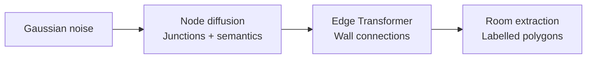

# Constraint-guided floorplan generation with SVDD

We adapt **Soft Value-Based Decoding (SVDD)** to guide a frozen GSDiff model using geometric constraints. At each guided step, we compare possible denoising moves through their predicted floorplans and continue the most promising eligible branch. The experiment tests whether this improves feasibility over ordinary sampling and Best-of-N at comparable denoiser cost.

## GSDiff: generating the geometry of a floorplan

Hu et al.'s **GSDiff: Synthesizing Vector Floorplans via Geometry-enhanced Structural Graph Generation** represents a floorplan through shared wall junctions and wall segments. Its central contribution is to generate this vector structure directly, with room semantics attached to the graph. [Paper](https://arxiv.org/abs/2408.16258)

### Two pretrained components, one generator

For a graph $G=(V,E)$, generation factorizes as

$$
p_{\mathrm{pre}}(G)=p_\theta(V)\,p_\phi(E\mid V).
$$

1. **Node generation:** a Transformer diffusion model generates junction coordinates, surrounding-room semantic attributes and background flags.
2. **Edge prediction:** a second Transformer predicts wall connections between node pairs. Room extraction then identifies closed polygonal loops and assigns room labels.

### What makes it geometry-enhanced?

The paper introduces a **mixed-base alignment loss** to penalize junction misalignment, and **interpolation self-supervision** to improve edge prediction using random intermediate points. These training objectives encourage geometric consistency. The paper also supports topology conditioning through a room-adjacency graph and boundary conditioning through a prescribed exterior contour. [Method, Figures 1–3](https://arxiv.org/pdf/2408.16258)

### Our use of the model

We use the released **unconditional RPLAN** checkpoints because our scenario prescribes neither topology nor boundary. Every comparison shares the same frozen networks and output representation; the original training losses are not optimized during our experiments.

The resulting polygons provide areas and regions for placement checks. Our output schema has no explicit doors, fixtures or ceiling heights. Metric conversion follows the documented RPLAN/GSDiff coordinate conventions below; we evaluate the observable geometric subset rather than infer missing building attributes.

This architecture determines where guidance must act: **we change node-sampling decisions, but score decoded graphs**. Edge prediction and room extraction introduce discrete decisions, making derivative-free SVDD suitable. Instability in early decoded predictions motivates comparing full-trajectory guidance with late guidance. The method must still establish structural validity and constraint satisfaction through final evaluation.

## SVDD-PM: search within the denoising trajectory

**Best-of-N** spends its budget on independent, complete designs and ranks them afterward. **SVDD** repeatedly branches from the current noisy state, using intermediate scores to decide where to continue. Each output retains one active trajectory; the other proposals are discarded at every guided step.

### The energy-tilted target

Our experiment uses **energy-based SVDD-PM**. Let $E(G)$ be the constraint energy defined below and $r(G)=-E(G)$. The [SVDD formulation](https://arxiv.org/html/2408.08252v3) motivates the target

$$
p_\beta(G)=\frac{p_{\mathrm{pre}}(G)e^{-\beta E(G)}}{Z_\beta},
\qquad \beta=1/\tau>0.
$$

This is the distribution minimizing expected violation while penalizing departure from the pretrained prior:

$$
p_\beta=\arg\min_q\left\{
\mathbb E_{G\sim q}[E(G)]
+\frac{1}{\beta}\mathrm{KL}(q\Vert p_{\mathrm{pre}})
\right\}.
$$

Larger $\beta$ strengthens the preference for low energy. Finite $\beta$ still permits violations.

### From final energy to a guided transition

Energy is defined on completed graphs, whereas diffusion operates on noisy nodes. The missing link is the expected terminal weight:

$$
H_t^\beta(z)=\mathbb E_{\mathrm{pre}}\!\left[e^{-\beta E(G)}\mid z_t=z\right],
\qquad
v_t^\beta(z)=\frac{1}{\beta}\log H_t^\beta(z).
$$

$H_t^\beta$ averages over the remaining denoising and edge-generation randomness; $v_t^\beta$ is the **soft value**. Given the pretrained transition $K_t(z'\mid z)$, the ideal reweighted transition is

$$
K_t^\beta(z'\mid z)
=K_t(z'\mid z)\frac{H_{t-1}^\beta(z')}{H_t^\beta(z)},
\qquad
H_t^\beta(z)=\int K_t(u\mid z)H_{t-1}^\beta(u)\,du.
$$

The ratio favors states with better expected terminal weights; the recursion makes it normalized wherever $H_t^\beta(z)>0$. These are ideal conditional transitions. Exact sampling of the full tilted process also requires consistent initial-noise and final-edge weighting, detailed in the [technical notes](technical_notes.md#exact-tilting-of-the-two-stage-generator).

### The posterior-mean approximation

A noisy node state cannot directly support room-area or clearance checks. For each proposal $z$, we predict clean nodes, discretize their semantics, predict edges and extract rooms:

$$
\widehat G_t(z)=D_\phi\!\left[\operatorname{Project}
    \bigl(\widehat z_{\mathrm{clean}}(z,t)\bigr)\right],
\qquad
\widehat H_t^\beta(z)=e^{-\beta E_{\mathrm{GPU}}(\widehat G_t(z))}.
$$

Thus $\widehat v_t(z)=\beta^{-1}\log\widehat H_t^\beta(z)=-E_{\mathrm{GPU}}(\widehat G_t(z))$. Here $D_\phi$ completes the graph. **One clean prediction and graph decode replace the expectation over future completions.** This needs neither rollouts, reward gradients nor a trained value network. The score is not expected terminal reward; early predictions can be unreliable, and GPU geometry is a proxy for the final CPU checker.

### Algorithm: one guided step

Given noisy nodes $z_t$ and $K=10$:

1. **Propose.** Compute the parent clean prediction once. Reuse it to draw $K$ noisy next states from the unchanged DDPM transition, each with independent Gaussian noise: $z_{t-1}^{(k)}\sim p_{\mathrm{pre}}(\cdot\mid z_t)$.
2. **Predict and score.** For each proposal, predict its clean nodes at timestep $t-1$, complete the graph and compute $\widehat v_{t-1}(z_{t-1}^{(k)})$. Sibling proposals share edge-decoder randomness to reduce comparison noise.
3. **Filter.** Require valid structure, finite reward and at least one measurable check. Relative to the first scorable proposal, forbid new unknown constraint IDs; then retain candidates with the fewest unknowns. Call this eligible set $\mathcal E_t$.
4. **Select.** For positive temperature, approximate the reweighted transition by sampling among eligible candidates:

$$
\Pr(k\mid\mathcal E_t)=
\frac{\widehat H_{t-1}^\beta(z_{t-1}^{(k)})}
{\sum_{\ell\in\mathcal E_t}\widehat H_{t-1}^\beta(z_{t-1}^{(\ell)})}
\propto e^{-\beta E_{\mathrm{GPU}}(\widehat G_{t-1}(z_{t-1}^{(k)}))}.
$$

5. **Continue.** Our default $\tau=0$ chooses the highest-scoring eligible proposal. Retain its **noisy state**, discard the other branches and resume denoising. If none is scorable, retain proposal zero.

The clean graph supplies the score; the noisy proposal supplies the next diffusion state. Replacing it with the clean estimate would skip the intended remaining denoising process.

**Guidance window.** Full SVDD applies this loop at code steps `999,…,1`; late SVDD applies it at `200,…,1`. Outside the window, take one ordinary DDPM transition. Both still execute all 1,000 steps, including deterministic, unguided step `0`, before final graph decoding and CPU evaluation.

Finite proposals, clean-estimate rewards, coverage filtering and the greedy default make our implementation **approximate inference-time optimization**. Temperature zero uses a deterministic argmax; it does not exactly sample the feasibility-conditioned model.

## Constraints define the reward

The default profile evaluates **eleven constraints from Appendix A** of the [assessment](../Technical_assessment_TTC.pdf), using three supporting measurement definitions:

| ID | Requirement |
|---|---|
| **C033** | A bedroom fits a bed and a separate **1.50 m diameter** turning circle. |
| **C035** | Bed clearances: **0.90 m** on both long sides + **1.20 m** at one short side, or **1.20 m + 0.90 m**. Joint success with C033 requires the same bed placement. |
| **C036** | A furnished bathroom fits a **1.50 m diameter** turning circle, sharing one fixture/door arrangement with C037/C041. |
| **C037** | A WC has **0.80 × 1.30 m** lateral transfer space, outside the door swing. |
| **C041** | **Bathroom-scoped:** the same turning circle overlaps the door swing by **≤0.25 m OR** the space beneath a basin by **≤0.15 m**; at most one overlap is used. |
| **C076** | One living room/bedroom satisfies **(area ≥9 m² AND height ≥2.20 m) OR volume ≥20 m³**. |
| **C077** | Habitable area ≥**28 m²** for two occupants. |
| **C078** | Habitable volume ≥**66 m³** for two occupants. |
| **C085** | Normal kitchen extraction meets the PDF's main-room-count table. |
| **C086** | Normal bathroom extraction meets the PDF's main-room-count table. |
| **C090** | Occupant-adjustable reduced ventilation meets **both total and kitchen** flow minima for the main-room count. |

**Scenario:** paper/code-derived scale **0.03515625 m/drawing pixel**, two occupants, uniform 2.5 m ceilings, an axis-aligned 1.40 × 1.90 m hypothetical bed and zero-thickness walls. Main rooms are living-room and bedroom polygons; every bathroom label is explicitly mapped to the full-bathroom category.

**Bathroom completion:** GSDiff provides neither fixtures nor doors. We therefore declare a combined bathroom/WC with a **0.40 × 0.70 m toilet**, **0.60 × 0.50 m basin** with clear space underneath, and **0.80 m inward-swinging door**. These dimensions and the combined-room programme are scenario assumptions, not PDF requirements. C041 is implemented for this bathroom circle only; bedroom door/fixture overlaps remain unverified. One shared search places these objects, the transfer rectangle and the turning circle together. Free transfer and turning spaces may overlap; solid fixtures obstruct them. A found layout establishes potential furnishing feasibility, not an observed fitted bathroom or an accessible route through the dwelling.

The declared ventilation system is fixed across all methods:

| Operating condition | Declared extraction rate |
|---|---:|
| Normal kitchen, per kitchen | **105 m³/h** |
| Normal bathroom, per bathroom | **30 m³/h** |
| Reduced mode, dwelling total | **75 m³/h** |
| Reduced mode, per kitchen | **45 m³/h** |

These are scenario capacities selected for a three-main-room dwelling; GSDiff generates the room count but does not predict these rates.

The ventilation threshold tables come from **Appendix A, page 7**. The declared capacities represent a three-main-room system and are held constant across methods. Missing equipment mappings or flows remain unknown. C090 is applicable only in the declared occupant-adjustable mode and uses its supplied table only for 1–7 main rooms. The model does not establish installed airflow, duct routing or inlet/outlet placement. Supporting C034/C079/C080 define measurements without adding compliance points.

**Scale calibration:** the [original RPLAN paper (§4)](https://wutomwu.github.io/publications/2019-DeepLayout/paper.pdf) describes an 18 m square encoded as 256 × 256 pixels. GSDiff's [normalization](../datasets/rplan-process4.py) uses $z=(x_{256}-128)/128$; our [decoder](../test_time/adapter.py) exports $x_{512}=\operatorname{trunc}(256z+256)$. Therefore,

$$
s=\frac{18}{512}=0.03515625\;\mathrm{m/drawing\ pixel},
\qquad A_{\mathrm{m}^2}=A_{\mathrm{pixel}^2}s^2.
$$

This conversion is derived from the dataset and code conventions, rather than a physical measurement of each generated building. Generation rewards and final checks use the same conversion.

For applicable, measurable checks $\mathcal M(G)$, equal-weight scalarization gives

$$
E(G)=100\,\mathbf 1\{G\text{ structurally invalid}\}
      +\sum_{j\in\mathcal M(G)}v_j(G),
\qquad r(G)=-E(G).
$$

Bedroom feasibility uses binary penalties. Dimensional and airflow deficits use normalized shortfalls $d(q;b)=\max(0,(b-q)/b)$. C085/C086 use their required flow for the generated main-room count. C090 uses $\max\{d(q_T^r;b_T^r),d(q_K^r;b_K^r)\}$ so sufficient total flow cannot compensate for insufficient kitchen flow. All eleven final checks have weight one. **Unknowns add no numeric severity and never count as passes.** Overall validity requires valid structure and every applicable scored check to pass; zero energy alone is insufficient.

**A shared bathroom search supplies a graded guidance score.** The same bounded bank of fixture/door placements and circle centres is used for every method. For a completion $a$, let $\ell(G,a)\geq0$ measure normalized containment, collision and permitted-overlap shortfalls. GPU guidance uses

$$
P_{\mathrm{bath}}(G)=\min_{a\in\mathcal A(G)}\ell(G,a),
\qquad
E_{\mathrm{GPU}}(G)=100\mathbf1\{\mathrm{invalid}\}
+\sum_{j\in\mathcal M(G)\setminus\{\mathrm{C036,C037,C041}\}}v_j(G)
+P_{\mathrm{bath}}(G).
$$

The joint term replaces the three bathroom severities during selection, avoiding counting the same geometric deficit three times. It gives near misses an ordering without labelling them proven failures. Final CPU reporting checks all three PDF rules separately; a finite search miss remains **unknown** unless a necessary geometric bound proves failure. The chosen shared arrangement is saved and drawn in the sample figures. [Constraint formulas](constraints.md) and the [bathroom protocol](bathroom_profile.md) specify the assumptions, overlap convention and search limitations.

## Evaluation and compute

**Results for this eleven-check profile are pending.** Baseline designs and the complete Best-of-11 candidate banks can be reused by rescoring them under the declared scenario. SVDD must use the same reward during generation. The table records planned denoiser budgets, not measured results:

| Method | Outputs | Planned NFE/output | Overall valid |
|---|---:|---:|---|
| Baseline | 100 | 1,000 | Pending |
| Best-of-3 | 100 | 3,000 | Pending |
| SVDD, last 20% | 100 | 3,000 | Pending |
| Best-of-11 | 100 | 11,000 | Pending |
| SVDD, full | 100 | 10,990 | Pending |

**Two budget comparisons:** Best-of-3 matches late SVDD at **3,000 NFE/output**; Best-of-11 approximately matches full SVDD at **11,000 versus 10,990**. Construct Best-of-3 from candidate indices **0, 1 and 2** in every saved Best-of-11 trial, fixed before inspecting scores. Reapply the same selection rule to their saved GPU scores, then CPU-audit the selected design. Retain all 100 trials and keep the Best-of-11 results. These are nested, paired controls rather than independent candidate banks.

**Pilot protocol:** 100 outputs per method with paired seeds `10000–10099`, shared frozen checkpoints, eleven scored checks and the scenario above. Final selected outputs use the CPU placement audit; preserve failed and unresolved cases in the denominators. Report ventilation, accessibility and habitability group results alongside overall success. Keep search budgets identical across methods, and report bathroom unknowns separately from proven failures.

Report overall validity with 95% Wilson intervals, per-constraint pass/fail/unknown rates, structural validity, measured severity and layout diversity. Record NFE and elapsed sampling/checking time separately. Sample-wise denoiser cost is $T+KG$ for SVDD and $NT$ for Best-of-N, where $G$ is the number of guided transitions; this does not match edge-model or checker cost.

Best-of-3's **3,000 NFE** is the equivalent generation cost of its retained prefix. Reselection performs no new model inference; the source bank already cost 11,000 NFE/output. Its standalone runtime and batched forward-call counts are unmeasured, so no speedup is inferred from this reuse.

The completed evaluation will include one comparison table, per-constraint results and labelled success/failure examples at the corrected metric scale. [Reproduction instructions](../test_time/README.md), [sweep launcher](../test_time/launch_eval.sh) and [machine-readable constraints](../test_time/configs/constraints_bathroom_v1.json) provide the assessment's baseline comparison, compute accounting and reproducibility requirements. One scenario and seed batch limit generalization; this profile does not guarantee a lower Best-of-N success rate or an SVDD advantage.

## Practical limits

**GPU evaluation** batches room extraction and constraint searches, avoiding repeated CPU geometry work inside the guidance loop. Bathroom completion uses tensor geometry; the final CPU audit independently verifies a saved positive placement witness. Final metrics use the CPU reference checker; search outcomes and severities can differ between backends.

Finite searches may remain unknown, bedroom binary penalties provide weak incremental feedback, and greedy selection may reduce diversity. The bathroom search covers a limited family of placements; it cannot certify that no other furnishing arrangement exists. At the assumed height, C077 already implies C078. C036/C037/C041 share geometry, and the fixed ventilation capacities correlate C085 with C090; the declared bathroom flow satisfies C086 across its table. These checks are not independent. Report room counts and diversity alongside success; baseline-relative diagnostics do not establish RPLAN fidelity.

[Technical notes](technical_notes.md) retain checkpoint details and exact process-weighting equations; their historical result tables are not part of this evaluation.

## Extensions: late hard-feasibility and repair-aware SVDD

These two algorithmic extensions use the same frozen checkpoints, eleven scored constraints and declared scenario. **Results are pending for both extensions.**

### Binary-rollout conditioning (`hard_h_mc`)

Let $C(G)=1$ only when structure and every applicable scored check pass. Unknowns are nonsuccesses. The desired distribution and continuation probability are

$$
p_F(G)=\frac{p_{\mathrm{pre}}(G)C(G)}{\Pr_{\mathrm{pre}}(C=1)},
\qquad h_t(z)=\mathbb E_{\mathrm{pre}}[C(G)\mid Z_t=z].
$$

Writing $q=\Pr_{\mathrm{pre}}(C=1)>0$, the ideal block kernel and first-anchor marginal are

$$
K^F_{a\to b}(z_b\mid z_a)
=K_{a\to b}(z_b\mid z_a)\frac{h_b(z_b)}{h_a(z_a)},
\qquad p_b^F(z)=\frac{p_b(z)h_b(z)}{q},
$$

with the kernel defined wherever $h_a(z_a)>0$. We draw **$K=4$ block proposals** and complete each with **$L=4$ independent unguided rollouts**:

$$
\widehat h_k=\frac1L\sum_{\ell=1}^{L}C(G_{k\ell}),
\qquad \Pr(I=k\mid\text{bank})=\frac{\widehat h_k}{\sum_j\widehat h_j}.
$$

Continuous severity never enters this stochastic selection. The faster default reduces $L$ from 16 to 4, giving noisier estimates and more all-zero banks. Anchors retain **200, 100 and 30 remaining transitions**. Independent initial noises and ordinary prefixes form the first bank, approximating $p_b^F$. Each completion includes GSDiff's actual edge decoder: random interpolation followed by edge-logit argmax and graph extraction.

Neural continuations are batched on GPU; completed-rollout feasibility uses the CPU audit. An all-zero bank triggers a recorded fresh ordinary block: zero observed successes do not prove impossibility. The final bank contains eight completions; selection is uniform among verified successes, otherwise the attempt fails. Finite proposal/rollout/terminal banks, fallbacks and a **40,000-NFE attempt cap** make this approximate conditioning. Success rates include failed attempts; retaining only successful episodes can further bias the distribution.

**Naming and target:** `hard_h_mc` estimates binary continuation probabilities online. The paper's [SVDD-MC (§4.3)](https://arxiv.org/html/2408.08252v5#S4.SS3) instead learns a value estimator by regression. The notes' limit $p_\beta\to p_F$ as $\beta\to\infty$ requires $E=0$ exactly on the feasible set. Our unknown checks carry no numeric severity, so $E=0$ alone does **not** establish feasibility; the explicit pass predicate is essential.

### Bounded repair lookahead (`svdd_repair_aware`)

At steps **200…1**, four noisy proposals are scored through bounded repairs of their predicted clean graphs. This is the **coordinate-only, greedy feasibility-first variant**. Among eligible found repairs $G'$, minimize the following tuple lexicographically:

$$
\mathcal L_G(G')=\left(1-C_{\mathrm{GPU}}(G'),\ U_{\mathrm{GPU}}(G'),\ E_{\mathrm{GPU}}(G'),\ D(G',G)\right),
\qquad
D(G',G)=\frac{\sum_i\|v'_i-v_i\|_2\;\text{(metres)}}{2.4\;\text{m}}.
$$

Here $C_{\mathrm{GPU}}$ is joint proxy feasibility and $U_{\mathrm{GPU}}$ counts unknown checks. Tensor proposals translate internal collinear junction groups by **±0.10 or ±0.20 m**, including bounded two-group combinations. Limits are **0.20 m per junction**, 12 moved junctions and 2.4 m total displacement, preserving adjacency, semantics and the exterior footprint. Search includes the unchanged graph and forbids introducing unknown checks.

For each predicted clean graph $\widehat G_k$, let $\mathcal S_B(\widehat G_k)$ be its finite eligible repair bank, and $\mathcal I_t$ the eligible noisy proposals. The two selections are

$$
\begin{aligned}
G_k^\star&=\operatorname*{arg\,min}^{\mathrm{lex}}_{G'\in\mathcal S_B(\widehat G_k)}\mathcal L_{\widehat G_k}(G'),\\
k^\star&=\operatorname*{arg\,min}^{\mathrm{lex}}_{k\in\mathcal I_t}\mathcal L_{\widehat G_k}(G_k^\star),
\qquad Z_{t-1}=Z_{t-1}^{(k^\star)}.
\end{aligned}
$$

An empty eligible repair bank falls back to its unchanged graph. The chosen **original noisy proposal** continues diffusion; with no eligible noisy proposal, ordinary proposal zero is retained. Inner scoring permits **16 repair evaluations per proposal**. Final repair permits 128 and applies the best eligible edit under the CPU ranking, additionally requiring preserved passes, no worsened severities and unchanged topology/footprint. Before/after graphs and edit costs remain distinguishable.

**Difference from the proposed weighted formulation:** the notes minimize $E+\lambda\|\Delta V\|^2$ (optionally with edge edits), then sample with weights $\exp(-\beta R)$. Our lexicographic rule uses fixed edges and summed displacement as its last tie-breaker; it is not that weighted objective's zero-temperature limit. The finite search supplies a repair witness, without global optimality. If every candidate retains the same feasibility, unknown count and energy—common with binary C035—the unchanged graph wins with zero displacement.

Final repair changes the output distribution and may still leave failed constraints. This combined intervention does not isolate guidance from final-repair effects; no ablation result, compute match or exact feasibility-conditioned distribution is claimed.

The existing finite wall-proposal order favours enlarging the largest bedroom. Adding bathroom scoring does not make that proposal bank target bathroom bottlenecks, and cannot guarantee a useful bathroom repair.

The [launcher](../test_time/launch_extensions.sh) previews repair-aware SVDD first, then `hard_h_mc`; `--run` executes that order. Defaults are 100 attempts per method starting at seed 10000, with inference microbatches of **32**, saved under `test_time/outputs/bathroom_extensions_001/`. `--smoke` retains two attempts with two hard-h rollouts and two terminal completions. Saved per-run configurations define the actual budgets, including earlier runs with $L=16$. See [reproduction instructions](../test_time/README.md).
