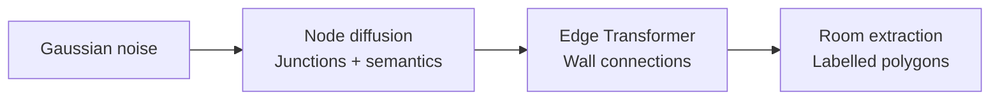
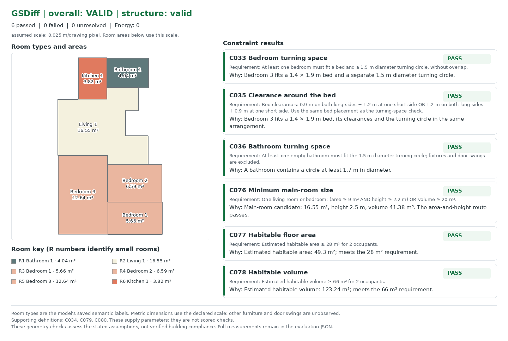

# Constraint-guided floorplan generation with SVDD

We adapt **Soft Value-Based Decoding (SVDD)** to guide a frozen GSDiff model using geometric constraints. At each guided step, we compare possible denoising moves through their predicted floorplans and continue the most promising eligible branch. The experiment tests whether this improves feasibility over ordinary sampling and Best-of-N at comparable denoiser cost.

## GSDiff: generating the geometry of a floorplan

Hu et al.'s **GSDiff: Synthesizing Vector Floorplans via Geometry-enhanced Structural Graph Generation** represents a floorplan through shared wall junctions and wall segments. Its central contribution is to generate this vector structure directly, with room semantics attached to the graph. [Paper](https://arxiv.org/abs/2408.16258)

### Two pretrained components, one generator

For a graph $G=(V,E)$, generation factorizes as

$$
p_{\mathrm{pre}}(G)=p_\theta(V)\,p_\phi(E\mid V).
$$

1. **Node generation:** a Transformer diffusion model generates junction coordinates, surrounding-room semantic attributes and background flags.
2. **Edge prediction:** a second Transformer predicts wall connections between node pairs. Room extraction then identifies closed polygonal loops and assigns room labels.

### What makes it geometry-enhanced?

The paper introduces a **mixed-base alignment loss** to penalize junction misalignment, and **interpolation self-supervision** to improve edge prediction using random intermediate points. These training objectives encourage geometric consistency. The paper also supports topology conditioning through a room-adjacency graph and boundary conditioning through a prescribed exterior contour. [Method, Figures 1–3](https://arxiv.org/pdf/2408.16258)

### Our use of the model

We use the released **unconditional RPLAN** checkpoints because our scenario prescribes neither topology nor boundary. Every comparison shares the same frozen networks and output representation; the original training losses are not optimized during our experiments.

The resulting polygons provide areas and regions for placement checks. Our output schema has no explicit doors, fixtures or ceiling heights, and metric scale remains an assumption. Thus, we evaluate the observable geometric subset rather than infer missing building attributes.

This architecture determines where guidance must act: **we change node-sampling decisions, but score decoded graphs**. Edge prediction and room extraction introduce discrete decisions, making derivative-free SVDD suitable. Instability in early decoded predictions motivates comparing full-trajectory guidance with late guidance. The method must still establish structural validity and constraint satisfaction through final evaluation.

## SVDD-PM: search within the denoising trajectory

**Best-of-N** spends its budget on independent, complete designs and ranks them afterward. **SVDD** repeatedly branches from the current noisy state, using intermediate scores to decide where to continue. Each output retains one active trajectory; the other proposals are discarded at every guided step.

### The energy-tilted target

Our experiment uses **energy-based SVDD-PM**. Let $E(G)$ be the constraint energy defined below and $r(G)=-E(G)$. The [SVDD formulation](https://arxiv.org/html/2408.08252v3) motivates the target

$$
p_\beta(G)=\frac{p_{\mathrm{pre}}(G)e^{-\beta E(G)}}{Z_\beta},
\qquad \beta=1/\tau>0.
$$

This is the distribution minimizing expected violation while penalizing departure from the pretrained prior:

$$
p_\beta=\arg\min_q\left\{
\mathbb E_{G\sim q}[E(G)]
+\frac{1}{\beta}\mathrm{KL}(q\Vert p_{\mathrm{pre}})
\right\}.
$$

Larger $\beta$ strengthens the preference for low energy. Finite $\beta$ still permits violations.

### From final energy to a guided transition

Energy is defined on completed graphs, whereas diffusion operates on noisy nodes. The missing link is the expected terminal weight:

$$
H_t^\beta(z)=\mathbb E_{\mathrm{pre}}\!\left[e^{-\beta E(G)}\mid z_t=z\right],
\qquad
v_t^\beta(z)=\frac{1}{\beta}\log H_t^\beta(z).
$$

$H_t^\beta$ averages over the remaining denoising and edge-generation randomness; $v_t^\beta$ is the **soft value**. Given the pretrained transition $K_t(z'\mid z)$, the ideal reweighted transition is

$$
K_t^\beta(z'\mid z)
=K_t(z'\mid z)\frac{H_{t-1}^\beta(z')}{H_t^\beta(z)},
\qquad
H_t^\beta(z)=\int K_t(u\mid z)H_{t-1}^\beta(u)\,du.
$$

The ratio favors states with better expected terminal weights; the recursion makes it normalized wherever $H_t^\beta(z)>0$. These are ideal conditional transitions. Exact sampling of the full tilted process also requires consistent initial-noise and final-edge weighting, detailed in the [technical notes](technical_notes.md#exact-tilting-of-the-two-stage-generator).

### The posterior-mean approximation

A noisy node state cannot directly support room-area or clearance checks. For each proposal $z$, we predict clean nodes, discretize their semantics, predict edges and extract rooms:

$$
\widehat G_t(z)=D_\phi\!\left[\operatorname{Project}
    \bigl(\widehat z_{\mathrm{clean}}(z,t)\bigr)\right],
\qquad
\widehat H_t^\beta(z)=e^{-\beta E_{\mathrm{GPU}}(\widehat G_t(z))}.
$$

Thus $\widehat v_t(z)=\beta^{-1}\log\widehat H_t^\beta(z)=-E_{\mathrm{GPU}}(\widehat G_t(z))$. Here $D_\phi$ completes the graph. **One clean prediction and graph decode replace the expectation over future completions.** This needs neither rollouts, reward gradients nor a trained value network. The score is not expected terminal reward; early predictions can be unreliable, and GPU geometry is a proxy for the final CPU checker.

### Algorithm: one guided step

Given noisy nodes $z_t$ and $K=10$:

1. **Propose.** Compute the parent clean prediction once. Reuse it to draw $K$ noisy next states from the unchanged DDPM transition, each with independent Gaussian noise: $z_{t-1}^{(k)}\sim p_{\mathrm{pre}}(\cdot\mid z_t)$.
2. **Predict and score.** For each proposal, predict its clean nodes at timestep $t-1$, complete the graph and compute $\widehat v_{t-1}(z_{t-1}^{(k)})$. Sibling proposals share edge-decoder randomness to reduce comparison noise.
3. **Filter.** Require valid structure, finite reward and at least one measurable check. Relative to the first scorable proposal, forbid new unknown constraint IDs; then retain candidates with the fewest unknowns. Call this eligible set $\mathcal E_t$.
4. **Select.** For positive temperature, approximate the reweighted transition by sampling among eligible candidates:

$$
\Pr(k\mid\mathcal E_t)=
\frac{\widehat H_{t-1}^\beta(z_{t-1}^{(k)})}
{\sum_{\ell\in\mathcal E_t}\widehat H_{t-1}^\beta(z_{t-1}^{(\ell)})}
\propto e^{-\beta E_{\mathrm{GPU}}(\widehat G_{t-1}(z_{t-1}^{(k)}))}.
$$

5. **Continue.** Our default $\tau=0$ chooses the highest-scoring eligible proposal. Retain its **noisy state**, discard the other branches and resume denoising. If none is scorable, retain proposal zero.

The clean graph supplies the score; the noisy proposal supplies the next diffusion state. Replacing it with the clean estimate would skip the intended remaining denoising process.

**Guidance window.** Full SVDD applies this loop at code steps `999,…,1`; late SVDD applies it at `200,…,1`. Outside the window, take one ordinary DDPM transition. Both still execute all 1,000 steps, including deterministic, unguided step `0`, before final graph decoding and CPU evaluation.

Finite proposals, clean-estimate rewards, coverage filtering and the greedy default make our implementation **approximate inference-time optimization**. Temperature zero uses a deterministic argmax; it does not exactly sample the feasibility-conditioned model.

## Geometry defines the reward

We score six accessibility/habitability checks from Appendix A of the [assessment](../Technical_assessment_TTC.pdf):

| ID | Geometric requirement |
|---|---|
| **C033** | A bedroom fits a bed and a separate **1.50 m diameter** turning circle. |
| **C035** | Bed clearances: **0.90 m** on both long sides + **1.20 m** at one short side, or **1.20 m + 0.90 m**. Joint success with C033 requires the same bed placement. |
| **C036** | An **empty bathroom** fits a **1.50 m diameter** turning circle. |
| **C076** | One living room/bedroom satisfies **(area ≥9 m² AND height ≥2.20 m) OR volume ≥20 m³**. |
| **C077** | Habitable area ≥**28 m²** for two occupants. |
| **C078** | Habitable volume ≥**66 m³** for two occupants. |

**Assumptions:** 0.025 m/drawing pixel, two occupants, uniform 2.5 m ceilings, a hypothetical axis-aligned 1.40 × 1.90 m bed and zero-thickness walls. Scale and height are supplied. Doors, swings, fixtures and navigable routes are unobserved; requirements needing them are excluded. Supporting rules C034/C079/C080 define measurements without adding compliance points.

For applicable, measurable checks $\mathcal M(G)$, equal-weight scalarization gives

$$
E(G)=100\,\mathbf 1\{G\text{ structurally invalid}\}
      +\sum_{j\in\mathcal M(G)}v_j(G),
\qquad r(G)=-E(G).
$$

Bedroom feasibility uses binary penalties. Dimensional deficits use normalized shortfalls $\max(0,(b-q)/b)$, combined according to each rule. **Unknowns add no numeric severity and never count as passes.** Overall validity requires valid structure and every applicable scored check to pass; zero energy alone is insufficient. The [constraint specification](constraints.md) gives exact formulas and assumptions.

## Evaluation and compute

**Protocol:** 100 selected outputs per method, paired seeds `10000–10099`, one fixed scenario, H100 80 GB, generation/inference batches 4/10. The CPU audit rechecks the original outputs; it changes neither generation rewards nor candidate selection.

**Table 1.** All methods score the same **six checks, with 100% applicability**. Validity includes all outputs; brackets give 95% Wilson intervals. Check success is passes/all applicable checks, including unknowns in the denominator. Severity averages measured penalties, excluding unknowns and the structural penalty. Room-count $W_1$ measures distribution shift from baseline (lower is closer).

| Method | Overall valid, % [95% CI] | Check success, % | Severity ↓ | Structure valid, % | Room-count $W_1$ ↓ | NFE/output | Seconds/output |
|---|---:|---:|---:|---:|---:|---:|---:|
| Baseline | 2 [0.6–7.0] | 63.8 | 0.185 | 86 | 0.000 | 1,000 | 3.54 |
| Best-of-11 | 9 [4.8–16.2] | 83.3 | 0.137 | 100 | 0.217 | 11,000 | 20.15 |
| SVDD, last 20% | 14 [8.5–22.1] | 83.7 | 0.142 | 98 | 0.150 | 3,000 | 84.68 |
| SVDD, full | 15 [9.3–23.3] | 85.0 | 0.135 | 99 | 0.138 | 10,990 | 230.05 |

**Compute:** sample-wise denoiser evaluations (NFE) cost $T+KL$ for SVDD and $NT$ for Best-of-N. Multipliers are **1× / 11× / 3× / 10.99×**, respectively. Best-of-11 matches full SVDD within 0.091% in NFE. NFE excludes edge/reward costs: full SVDD takes **11.4× longer** than Best-of-11. Timings exclude loading, rendering and the offline audit.

**Interpretation:** full SVDD has the highest observed validity, but 15 versus 14 successes does not establish an advantage over late guidance. This ablation changes both guidance timing and budget. C035 fails in **80/100** full-SVDD outputs and is the sole scored failure in 76; C036 passes in 99. Clearance envelopes need at least **9.92 m²**, explaining many small-bedroom failures.

**Diversity:** among usable, structurally valid outputs (86/100/98/99), all graphs are unique and mean pairwise semantic-layout distance stays near **0.804–0.807**. This shows no obvious collapse under these diagnostics, not equivalence to RPLAN. Unknown-check rates are 9.3%/0%/2.3%/0.8%; an unresolved placement search is not proof of impossibility. [Metrics and complete analysis](../test_time/outputs/sweep_002_cpu_audit_v2/analysis/REPORT.md).

### One successful SVDD design

**Figure 1.** First valid full-SVDD output in trial order: seed **10009**, valid structure, **six passes, zero unknowns**. Bedroom 3 accommodates the bed, clearances and turning circle together. Habitable area is **49.30 m²** and volume **123.24 m³**. The [paired baseline](../test_time/outputs/sweep_002_cpu_audit_v2/analysis/samples/01_baseline/trial-0009-sample-0009.svg) fails C035 (largest bedroom 8.41 m² <9.92 m²) and C036 (circle diameter upper bound 1.20 m <1.50 m). This is an illustrative pair. [SVG](assets/svdd_full_seed10009.svg) · [Vector graph](assets/svdd_full_seed10009_graph.json) · [Check evidence](assets/svdd_full_seed10009_evaluation.json).

### Assessment coverage

The experiments address the assessment's baseline comparison, compute accounting, guidance-window ablation and annotated vector outputs. [Reproduction instructions](../test_time/README.md), [sweep launcher](../test_time/launch_eval.sh) and [machine-readable constraints](../test_time/configs/constraints_v2.json) accompany this report. New logic lives in `test_time/`; the upstream change to [`house_nn2.py`](../gsdiff/house_nn2.py) supplies reproducible edge randomness. The registry's explicit per-rule severity formulas/output-field mapping still need completing; formulas are currently documented separately.

This evaluation covers one fixed scenario and one seed batch; broader replication remains necessary.

## Practical limits

**GPU evaluation** batches room extraction and constraint searches, avoiding repeated CPU geometry work inside the guidance loop. Final metrics use the CPU reference checker; search outcomes and severities can differ between backends.

Finite searches may remain unknown, binary penalties provide weak incremental feedback, and greedy selection may reduce diversity. At the assumed height, C077 already implies C078, partly duplicating the objective. Results establish feasibility under the stated assumptions; baseline-relative diagnostics do not establish RPLAN fidelity.

[Technical notes](technical_notes.md) retain checkpoint details, exact process-weighting equations, assessment alignment and extended results tables.

## Extensions: late hard-feasibility and repair-aware SVDD

These two extensions keep the frozen checkpoints, six scored constraints and scenario assumptions above. **Results for these new extensions are pending**; the preceding audited experiments are unchanged.

### Binary-rollout conditioning (`hard_h_mc`)

Let $C(G)=1$ only when structure and every applicable scored check pass. Unknowns are nonsuccesses. The desired distribution and continuation probability are

$$
p_F(G)=\frac{p_{\mathrm{pre}}(G)C(G)}{\Pr_{\mathrm{pre}}(C=1)},
\qquad h_t(z)=\mathbb E_{\mathrm{pre}}[C(G)\mid Z_t=z].
$$

For a block of ordinary denoising steps, the ideal conditioned kernel is

$$
K^F_{a\to b}(z_b\mid z_a)
=K_{a\to b}(z_b\mid z_a)\frac{h_b(z_b)}{h_a(z_a)}.
$$

We draw **four block proposals**, complete each with **16 independent unguided rollouts**, and resample proportional to $\widehat h_b=\frac1{16}\sum_\ell C(G_\ell)$. Continuous severity never enters this selection. Anchors retain **200, 100 and 30 remaining transitions**. Independent initial noises and ordinary prefixes form the first bank, approximating the conditioned first-anchor marginal instead of fixing an unweighted root state.

Neural continuations are batched on GPU; completed-rollout feasibility uses the CPU audit. An all-zero bank triggers a fresh ordinary block, explicitly recording the fallback. The final bank contains eight completions; selection is uniform among verified successes, otherwise the attempt fails without returning a least-bad design. Finite banks, fallbacks and a **40,000-NFE attempt cap** prevent claims of exact conditional sampling. Success rates must include failed attempts.

### Bounded repair lookahead (`svdd_repair_aware`)

At steps **200…1**, four noisy proposals are scored through bounded repairs of their predicted clean graphs. Among eligible found repairs $G'$, minimize the following tuple lexicographically:

$$
\left(1-C_{\mathrm{GPU}}(G'),\ U_{\mathrm{GPU}}(G'),\ E_{\mathrm{GPU}}(G'),\ D(G',G)\right),
\qquad
D(G',G)=\frac{\sum_i\|v'_i-v_i\|_2\;\text{(metres)}}{2.4\;\text{m}}.
$$

Here $C_{\mathrm{GPU}}$ is joint proxy feasibility and $U_{\mathrm{GPU}}$ counts unknown checks. This is a searched witness, not a global minimum. Tensor proposals move internal collinear junction groups by at most **0.20 m per junction**, with at most 12 moved junctions and 2.4 m total displacement, preserving adjacency, semantics and the exterior footprint. Search includes the unchanged graph and forbids introducing unknown checks.

The chosen **original noisy proposal** continues diffusion; repaired clean coordinates are not injected into it. Inner scoring allows 16 candidate evaluations; final repair allows 128 and is actually applied, subject to CPU audit acceptance. Before/after graphs and edit costs remain distinguishable. GPU proxy success alone is insufficient. This combined intervention does not isolate guidance from final-repair effects; no ablation result or compute match is claimed.

The [launcher](../test_time/launch_extensions.sh) previews both methods by default; `--smoke` previews two attempts with smaller banks, and `--run` explicitly executes. Defaults are 100 attempts per method starting at seed 10000, saved under `test_time/outputs/extensions_001/`. See [reproduction instructions](../test_time/README.md).
